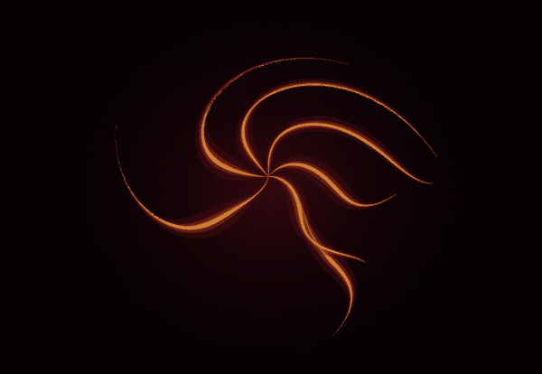
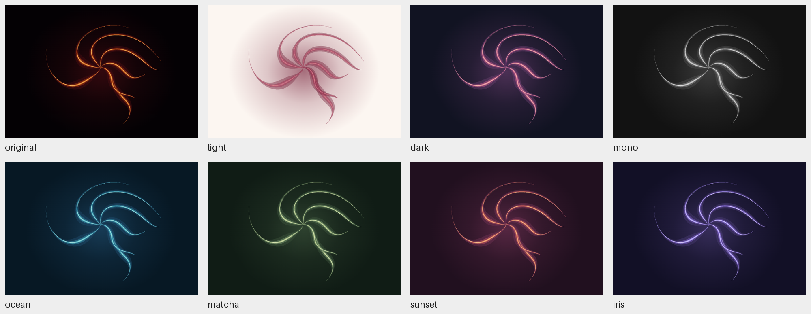

# Ember petal vortex

Seven fine amber filaments curl and stretch around a wandering ember in a dark field.

| | |
| --- | --- |
| **Category** | [Animations › Particles](../) |
| **Size** | 576 × 397 |
| **Colorways** | original, light, dark, mono, ocean, matcha, sunset, iris |
| **Fonts** | No visible text |
| **Icons** | Original procedural SVG geometry |
| **Animated** | 8 seconds, 24 fps |
| **Based on** | [A TikTok by @paulcodes4](https://www.tiktok.com/@paulcodes4/video/7706526477956713734) |

## Every colorway

## Files

- Open [the editable drawing](source/design.html) to watch the loop. Append a colorway such as `#ocean` or use `?t=0#original` to pause it.
- The [exports](exports/) include a full-size still and H.264 loop in every colorway.

## Changing it

The moving center bends each filament continuously. Moving the pointer nudges the field. Each color token lives in the palette blocks at the top of the HTML. Run `python3 .github/scripts/export_design.py animations/particles/ember-petal-vortex` to refresh the media.
