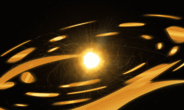
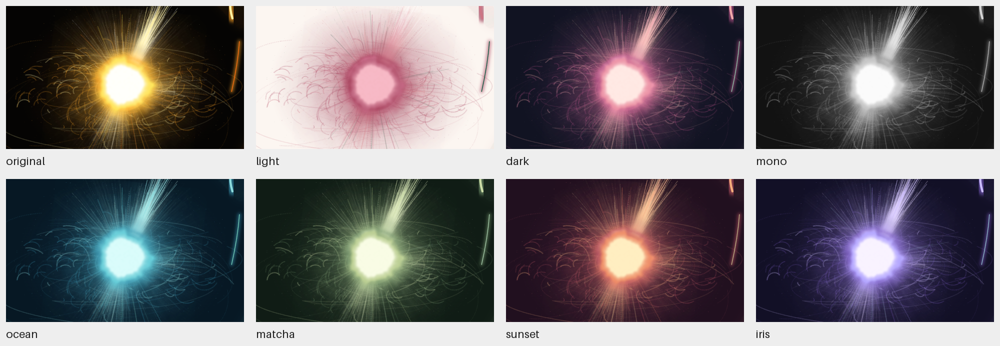

# Golden flare chamber

Gold bands sweep around a white-hot sphere. Its surface flares into fine rays and an upper-right jet before the view withdraws into a chamber of segmented light.

| | |
| --- | --- |
| **Category** | [Animations › Particles](../) |
| **Size** | 576 × 346 |
| **Colorways** | original, light, dark, mono, ocean, matcha, sunset, iris |
| **Fonts** | No visible text |
| **Icons** | Original SVG geometry and embedded procedural alpha masks |
| **Animated** | 14.8 seconds, 24 fps |
| **Based on** | [A TikTok by @paulcodes4](https://www.tiktok.com/@paulcodes4/video/7692091153851649301) |

## Every colorway

## Files

- Open [the editable drawing](source/design.html) to watch the loop. Append a colorway such as `#ocean` or use `?t=8.7#original` to pause it.
- The [exports](exports/) include a full-size still and H.264 loop in every colorway.

## Changing it

Seeded optical-density textures give the sphere and its fine rays their changing brightness. The opening rings lie low across the frame. Near the sphere, fine curved orbits and a narrow jet move at different speeds. The view then retreats until the segmented outer rings surround the shrinking flare. Each color token lives in the palette blocks at the top of the HTML. Run `python3 .github/scripts/export_design.py animations/particles/golden-flare-chamber` to refresh the media.
