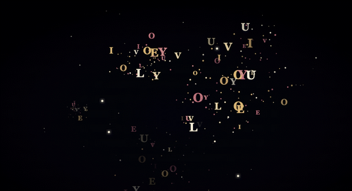
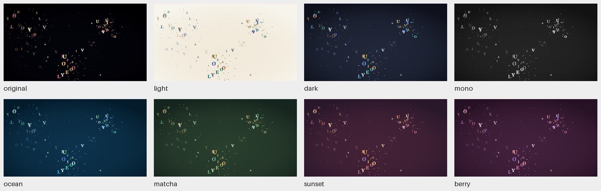

# Love letter fireworks

Fireworks burst into individual love-letter characters and tiny sparks over a dark blue-black sky.

| | |
| --- | --- |
| **Category** | [Animations › Particles](../) |
| **Size** | 576 × 312 CSS pixels, 2× export |
| **Colorways** | original, light, dark, mono, ocean, matcha, sunset, berry |
| **Fonts** | Georgia or the local serif fallback. |
| **Artwork** | Original procedural illustration and SVG geometry, drawn for Motherlode |
| **Animated** | Yes, 5.8-second loop |
| **Based on** | [A TikTok by @paulcodes4](https://www.tiktok.com/@paulcodes4/video/7693448325797776661) |

## Every colorway

## Files

- `source/design.html` is the standalone artwork. Its address accepts a palette such as `#matcha` and a preview time such as `?t=3.8#ocean`.
- `exports/` contains each palette’s PNG still and H.264 loop.

## Changing it

Each burst has a separate launch point and phase. Its trajectories spread tiny sparks and individual letters from the message “I love you.” The colorway blocks at the top of the source define the inks and ground. Run `python3 .github/scripts/export_design.py animations/particles/love-letter-fireworks` to regenerate the exports.
