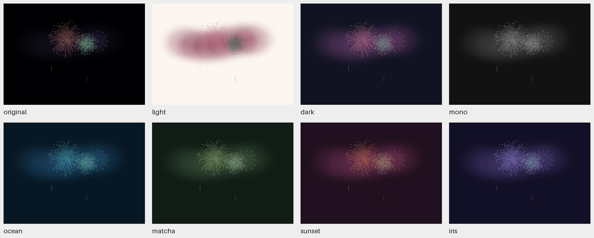

# Midnight firework rings

Fine points of light burst into rings, small hearts and starbursts over a quiet violet haze.

| | |
| --- | --- |
| **Category** | [Animations › Particles](../) |
| **Size** | 576 × 414 |
| **Colorways** | original, light, dark, mono, ocean, matcha, sunset, iris |
| **Fonts** | No visible text |
| **Icons** | Original procedural SVG geometry |
| **Animated** | 6 seconds, 24 fps |
| **Based on** | [A TikTok by @paulcodes4](https://www.tiktok.com/@paulcodes4/video/7698266995707399444) |

## Every colorway

## Files

- Open [the editable drawing](source/design.html) to watch the loop. Append a colorway such as `#ocean` or use `?t=3.3#original` to pause it.
- The [exports](exports/) include a full-size still and H.264 loop in every colorway.

## Changing it

Each shell rises from the lower edge. The relative radii, launch height, timing and spread can be edited separately. Each color token lives in the palette blocks at the top of the HTML. Run `python3 .github/scripts/export_design.py animations/particles/midnight-firework-rings` to refresh the media.
