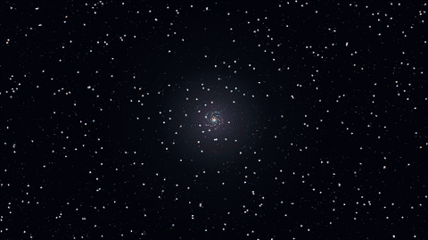
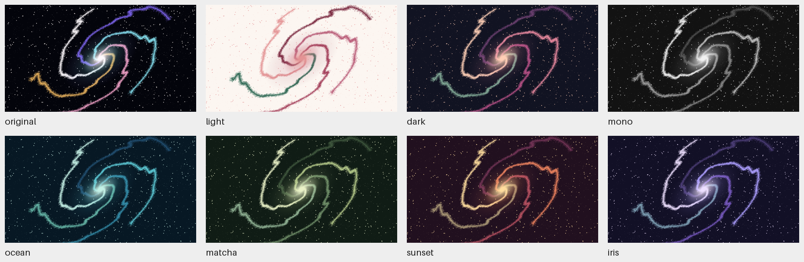

# Prismatic stellar arms

Five luminous strands unfurl around a white point of light and flatten into a bright, edge-on spiral.

| | |
| --- | --- |
| **Category** | [Animations › Particles](../) |
| **Size** | 464 × 260 |
| **Colorways** | original, light, dark, mono, ocean, matcha, sunset, iris |
| **Fonts** | No visible text |
| **Icons** | Original procedural SVG geometry |
| **Animated** | 13 seconds, 24 fps |
| **Based on** | [A TikTok by @paulcodes4](https://www.tiktok.com/@paulcodes4/video/7706433420842323221) |

## Every colorway

## Files

- Open [the editable drawing](source/design.html) to watch the loop. Append a colorway such as `#ocean` or use `?t=5#original` to pause it.
- The [exports](exports/) include a full-size still and H.264 loop in every colorway.

## Changing it

The stellar lanes combine linework and scattered points with an independently timed central flare. Each color token lives in the palette blocks at the top of the HTML. Run `python3 .github/scripts/export_design.py animations/particles/prismatic-stellar-arms` to refresh the media.
