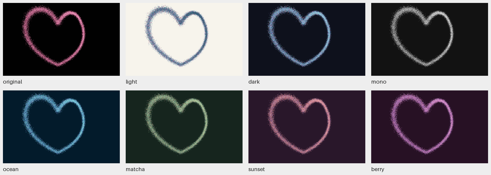

# Rose dust heart

A soft pink particle stream traces an asymmetrical heart on black, closing at the lower point before it dissolves.

| | |
| --- | --- |
| **Category** | [Animations › Particles](../) |
| **Size** | 576 × 360 CSS pixels, 2× export |
| **Colorways** | original, light, dark, mono, ocean, matcha, sunset, berry |
| **Fonts** | None. The artwork contains no lettering. |
| **Artwork** | Original procedural illustration and SVG geometry, drawn for Motherlode |
| **Animated** | Yes, 5.6-second loop |
| **Based on** | [A TikTok by @paulcodes4](https://www.tiktok.com/@paulcodes4/video/7693974828600085781) |

## Every colorway

## Files

- `source/design.html` is the standalone artwork. Its address accepts a palette such as `#matcha` and a preview time such as `?t=4.0#ocean`.
- `exports/` contains each palette’s PNG still and H.264 loop.

## Changing it

The heart is a closed, editable four-segment Bézier curve. Particle positions spread across its local normal and tangent, with staggered groups creating the traveling trace. The colorway blocks at the top of the source define the inks and ground. Run `python3 .github/scripts/export_design.py animations/particles/rose-dust-heart` to regenerate the exports.
