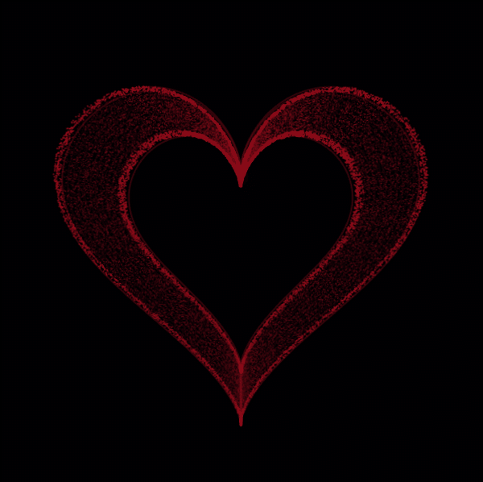
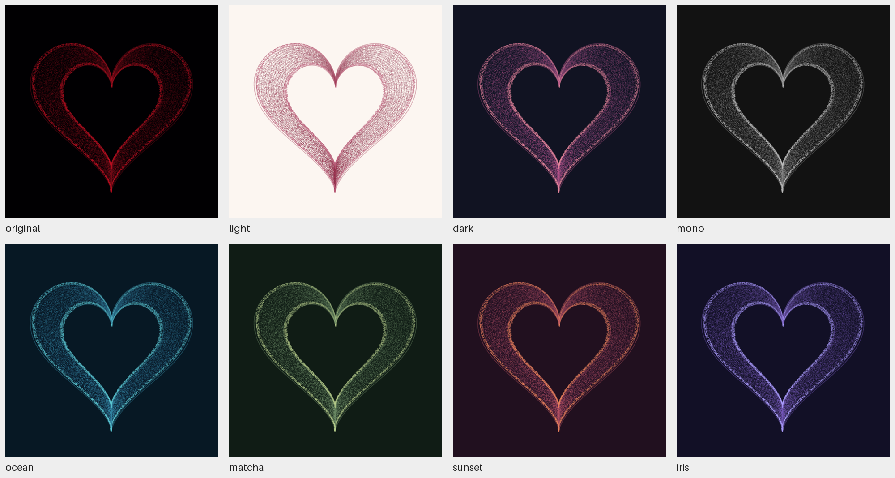

# Ruby ribbon heart

A red band of fine particles rolls between a pointed outer heart and its smaller hollow center.

| | |
| --- | --- |
| **Category** | [Animations › Particles](../) |
| **Size** | 576 × 574 |
| **Colorways** | original, light, dark, mono, ocean, matcha, sunset, iris |
| **Fonts** | No visible text |
| **Icons** | Original procedural SVG geometry |
| **Animated** | 7.5 seconds, 24 fps |
| **Based on** | [A TikTok by @paulcodes4](https://www.tiktok.com/@paulcodes4/video/7701020897473482005) |

## Every colorway

## Files

- Open [the editable drawing](source/design.html) to watch the loop. Append a colorway such as `#ocean` or use `?t=3.5#original` to pause it.
- The [exports](exports/) include a full-size still and H.264 loop in every colorway.

## Changing it

A seeded cloud follows the inner and outer contours. Several depth bands shift separately to reproduce the rolling highlights. Each color token lives in the palette blocks at the top of the HTML. Run `python3 .github/scripts/export_design.py animations/particles/ruby-ribbon-heart` to refresh the media.
