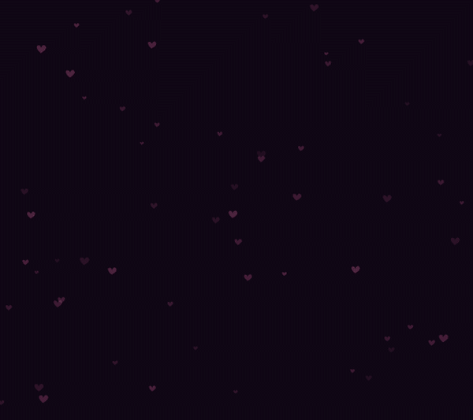
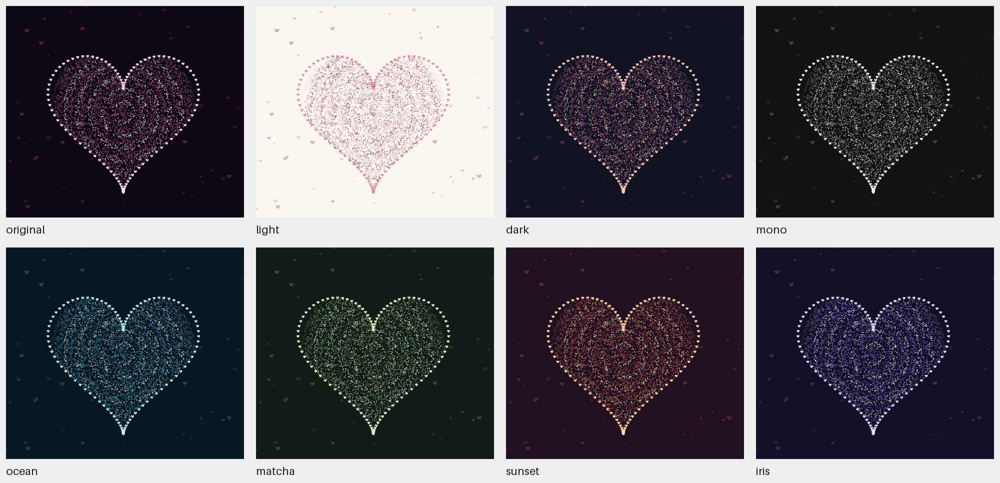

# Starlit pulse heart

Two paths of tiny pink lights meet at the cleft of a heart, then a cloud of rose stardust fills the outline.

| | |
| --- | --- |
| **Category** | [Animations › Particles](../) |
| **Size** | 576 × 512 |
| **Colorways** | original, light, dark, mono, ocean, matcha, sunset, iris |
| **Fonts** | No visible text |
| **Icons** | Original procedural SVG geometry |
| **Animated** | 13.5 seconds, 24 fps |
| **Based on** | [A TikTok by @paulcodes4](https://www.tiktok.com/@paulcodes4/video/7701630672946990356) |

## Every colorway

## Files

- Open [the editable drawing](source/design.html) to watch the loop. Append a colorway such as `#ocean` or use `?t=12#original` to pause it.
- The [exports](exports/) include a full-size still and H.264 loop in every colorway.

## Changing it

The outline grows from its lower point on both sides. Nineteen groups of points fill its center in sequence. Each color token lives in the palette blocks at the top of the HTML. Run `python3 .github/scripts/export_design.py animations/particles/starlit-pulse-heart` to refresh the media.
