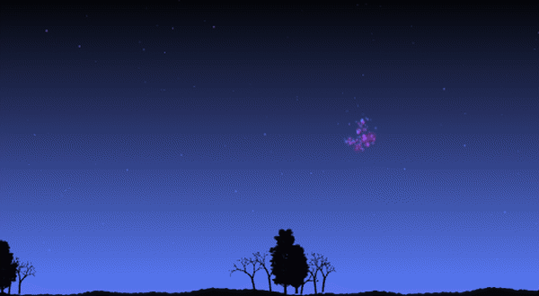
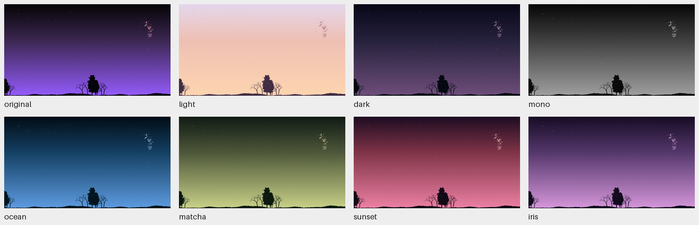

# Violet forest starfall

A violet horizon silhouettes small trees. A loose cluster of stars travels above the treeline as the dusk colors shift.

| | |
| --- | --- |
| **Category** | [Animations › Particles](../) |
| **Size** | 476 × 262 |
| **Colorways** | original, light, dark, mono, ocean, matcha, sunset, iris |
| **Fonts** | No visible text |
| **Icons** | Original procedural SVG geometry |
| **Animated** | 12 seconds, 24 fps |
| **Based on** | [A TikTok by @paulcodes4](https://www.tiktok.com/@paulcodes4/video/7697526253246713108) |

## Every colorway

## Files

- Open [the editable drawing](source/design.html) to watch the loop. Append a colorway such as `#ocean` or use `?t=7.8#original` to pause it.
- The [exports](exports/) include a full-size still and H.264 loop in every colorway.

## Changing it

The sky crossfades from blue dusk to violet above a low, uneven treeline. Nine groups of sparks travel along the observed route with a short lag between groups. Move the pointer to guide them and leave the scene to resume the loop. Each color token lives in the palette blocks at the top of the HTML. Run `python3 .github/scripts/export_design.py animations/particles/violet-forest-starfall` to refresh the media.
