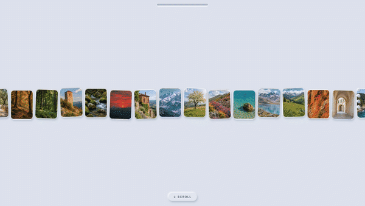

<!-- Generated by .github/scripts/build_catalog.py. Edit that file, not this one. -->
# Scroll animations

Scroll-triggered animations.

Part of [Animations](../).

## Designs (1)

<table>
<tr><td align="center" valign="top" width="33%"> <a href="neumorphic-photo-orbit/"><b>Neumorphic photo orbit</b></a> 8 colorways</td></tr>
</table>

Adding one? See [Adding a design](../../README.md#adding-a-design).
