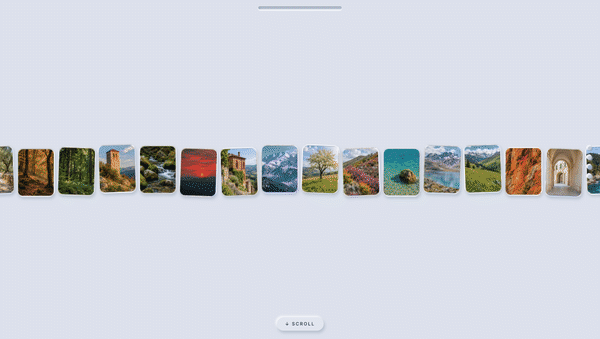
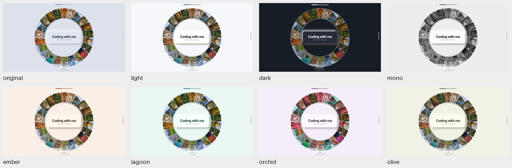

# Neumorphic photo orbit

A row of small landscape photographs curls into a complete ring around a soft inset title. Further scrolling scatters the pictures to reveal a second raised panel.

| | |
| --- | --- |
| **Category** | [Animations › Scroll animations](../) |
| **Size** | 1152 × 650 CSS pixels, exported at 2× |
| **Colorways** | original, light, dark, mono, ember, lagoon, orchid, olive |
| **Fonts** | Inter (bundled Latin subset from Google Fonts, SIL Open Font License) |
| **Icons** | Original inline SVG and CSS |
| **Animated** | Yes, 8-second loop at 24 fps |
| **Based on** | [A TikTok by @paulcodes4](https://www.tiktok.com/@paulcodes4/video/7700129316876668181) |

## Every colorway

## Files

- Open [the design](source/design.html) in a browser and append `#ember` to select that colorway. Add `?t=3.2#ember` after the filename to show the export still.
- [The exports folder](exports/) contains a PNG and an H.264 MP4 loop for each colorway.
- [The font folder](source/fonts/) includes the font files and their licenses.

## Changing it

Scroll, drag vertically or use the arrow keys to scrub the picture row into the ring and on to the second section. Replay restarts the automated sequence. The pictures come from an original photographic atlas.

The custom properties at the top of `source/design.html` define each palette. Copy a palette block, give it a new colorway name, then run `python3 .github/scripts/export_design.py animations/scroll-animations/neumorphic-photo-orbit` from the repository root.
