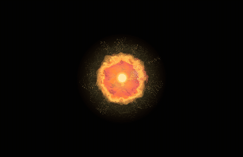
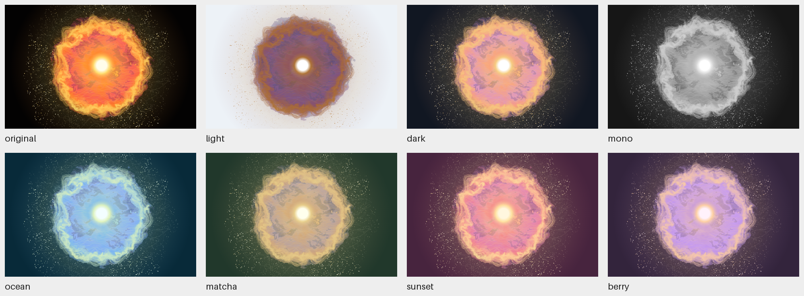

# Molten stellar corona

A hot white center illuminates a rippling golden plasma shell. The camera moves close to the luminous surface, backs out and follows a pink flare across its edge.

| | |
| --- | --- |
| **Category** | [Animations › Shaders](../) |
| **Size** | 576 × 373 CSS pixels, exported at 2× |
| **Colorways** | original, light, dark, mono, ocean, matcha, sunset, berry |
| **Fonts** | System sans serif |
| **Artwork** | Original procedural particle field, warped spherical filaments and radial emission. |
| **Animated** | Yes, 18.75-second loop at 24 fps |
| **Based on** | [A TikTok by @paulcodes4](https://www.tiktok.com/@paulcodes4/video/7697535208152730900) |

## Every colorway

## Files

- [Open the standalone design](source/design.html). Move the pointer to shift the framing or scroll to change the camera distance.
- Add `#ocean` to switch palettes or `?t=6.5#ocean` to freeze the animation.
- [Exports](exports/) holds the colorway PNGs and H.264 loops.

## Changing it

Edit the palette variables at the top of [the source](source/design.html), then run `python3 .github/scripts/export_design.py animations/shaders/molten-stellar-corona` from the repository root.
