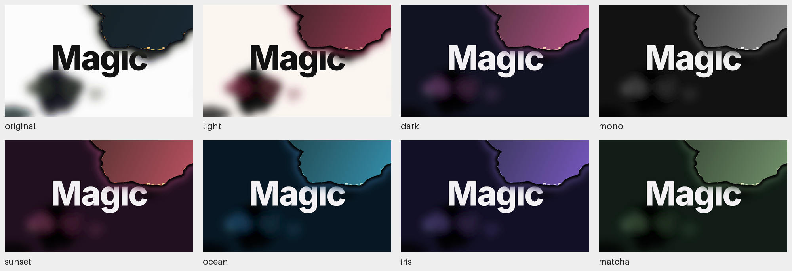

# Ember ink type reveal

Dark charred edges break through a white Magic title. A narrow amber rim follows the dissolving paper to reveal a dark editorial message.

| | |
| --- | --- |
| **Category** | [Animations › Text Animations](../) |
| **Size** | 576 × 342 CSS pixels, exported at 2× |
| **Colorways** | original, light, dark, mono, ocean, matcha, sunset, iris |
| **Fonts** | Inter (bundled Latin subset from Google Fonts, SIL Open Font License) |
| **Icons** | Original inline SVG and CSS |
| **Animated** | Yes, 7.5-second loop at 24 fps |
| **Based on** | [A TikTok by @paulcodes4](https://www.tiktok.com/@paulcodes4/video/7692059672710270229) |

## Every colorway

## Files

- Open [the design](source/design.html) in a browser and append `#ocean` to select that colorway. Add `?t=2.9#ocean` after the filename to show the export still.
- [The exports folder](exports/) contains a PNG and an H.264 MP4 loop for each colorway.
- [The font folder](source/fonts/) includes the font files and their licenses.

## Changing it

Click the scene or press Enter to replay the paper burn. A smoke stain forms above the title, followed by an upper-right tear, a second opening below and a dark page with a warm headline. Original vector contours, soft charcoal shadows and broken ember lines form the edge.

The custom properties at the top of `source/design.html` define each palette. Copy a palette block, give it a new colorway name, then run `python3 .github/scripts/export_design.py animations/text-animations/ember-ink-type-reveal` from the repository root.
