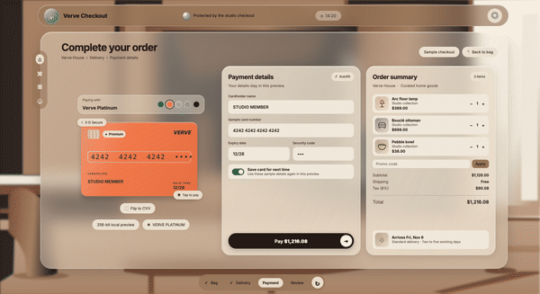
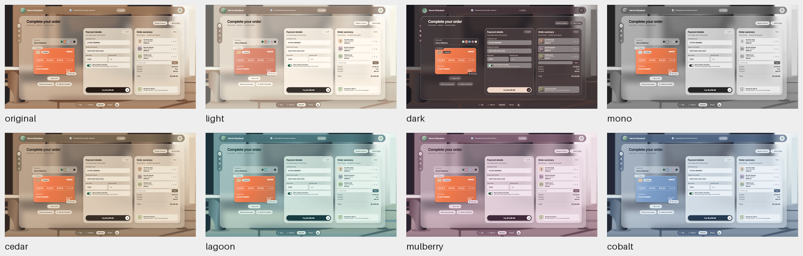

# Walnut glass checkout

A three-column glass checkout places a turnable coral card beside its payment details and a furniture order. The card moves to the center while the order is processed, then turns green on completion.

| | |
| --- | --- |
| **Category** | [App screens › Checkout](../) |
| **Size** | 1152 × 628 CSS pixels, exported at 2× |
| **Colorways** | original, light, dark, mono, cedar, lagoon, mulberry, cobalt |
| **Fonts** | Inter (bundled Latin subset from Google Fonts, SIL Open Font License) |
| **Icons** | Original inline SVG and CSS |
| **Animated** | Yes, 6-second loop at 24 fps |
| **Based on** | [A TikTok by @paulcodes4](https://www.tiktok.com/@paulcodes4/video/7703987739850460436) |

## Every colorway

## Files

- Open [the design](source/design.html) in a browser and append `#cedar` to select that colorway. Add `?t=0.3#cedar` after the filename to show the export still.
- [The exports folder](exports/) contains a PNG and an H.264 MP4 loop for each colorway.
- [The font folder](source/fonts/) includes the font files and their licenses.

## Changing it

The form uses local sample details and an original vector room. Flip the card to inspect its back, pick a swatch, change item quantities or place the sample order. The confirmation control returns to the checkout.

The custom properties at the top of `source/design.html` define each palette. Copy a palette block, give it a new colorway name, then run `python3 .github/scripts/export_design.py app-screens/checkout/walnut-glass-checkout` from the repository root.
