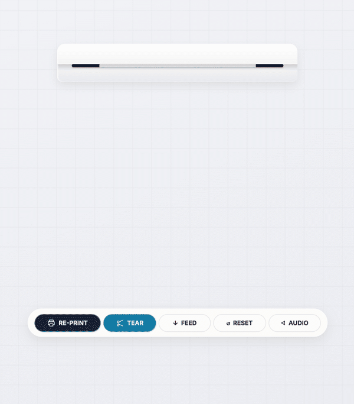
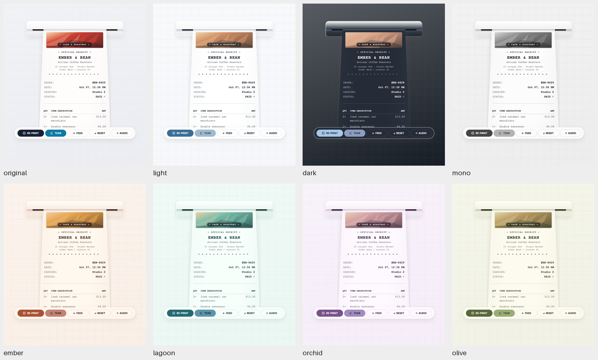

# Desktop receipt printer

A thermal receipt feeds from a white desktop printer over a faint square grid. Its paper carries a red coffee-house header, typeset order details and a tear-off edge.

| | |
| --- | --- |
| **Category** | [App screens › Success states](../) |
| **Size** | 864 × 984 CSS pixels, exported at 2× |
| **Colorways** | original, light, dark, mono, ember, lagoon, orchid, olive |
| **Fonts** | Inter (bundled Latin subset from Google Fonts, SIL Open Font License) |
| **Icons** | Original inline SVG and CSS |
| **Animated** | Yes, 6-second loop at 24 fps |
| **Based on** | [A TikTok by @paulcodes4](https://www.tiktok.com/@paulcodes4/video/7701614222093880597) |

## Every colorway

## Files

- Open [the design](source/design.html) in a browser and append `#ember` to select that colorway. Add `?t=3.55#ember` after the filename to show the export still.
- [The exports folder](exports/) contains a PNG and an H.264 MP4 loop for each colorway.
- [The font folder](source/fonts/) includes the font files and their licenses.

## Changing it

Print or feed the sample receipt, tear it from the mechanism, or reset the desk. The audio toggle plays short synthesized mechanical clicks during local interactions. The receipt’s artwork, business and sample transaction are original.

The custom properties at the top of `source/design.html` define each palette. Copy a palette block, give it a new colorway name, then run `python3 .github/scripts/export_design.py app-screens/success-states/desktop-receipt-printer` from the repository root.
