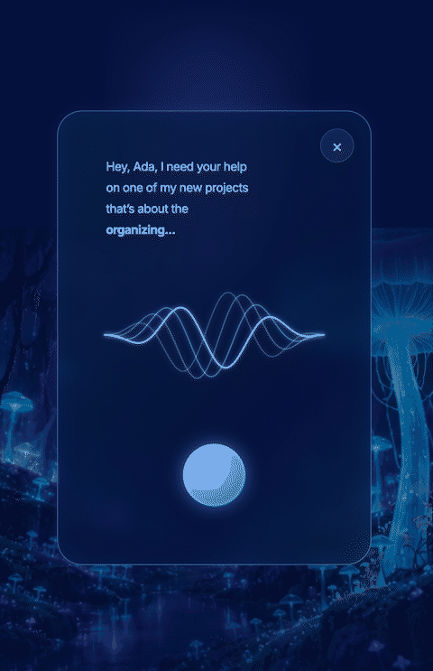
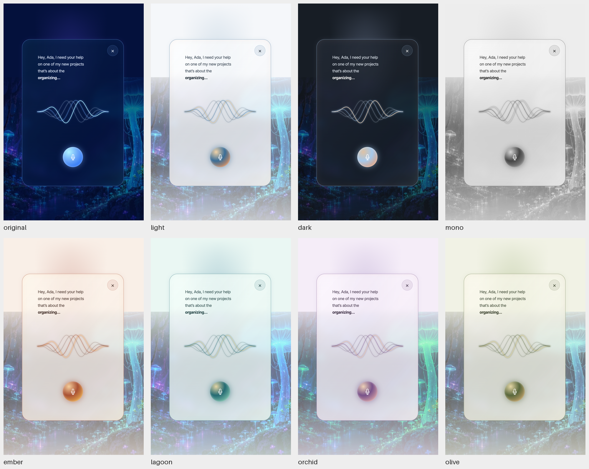

# Blue spore voice panel

A translucent navy voice panel floats over a bioluminescent mushroom forest. Three fine waveforms move above a luminous round microphone button.

| | |
| --- | --- |
| **Category** | [Apps › AI assistants](../) |
| **Size** | 864 × 1338 CSS pixels, exported at 2× |
| **Colorways** | original, light, dark, mono, ember, lagoon, orchid, olive |
| **Fonts** | Inter (bundled Latin subset from Google Fonts, SIL Open Font License) |
| **Icons** | Original inline SVG and CSS |
| **Animated** | Yes, 6-second loop at 24 fps |
| **Based on** | [A TikTok by @paulcodes4](https://www.tiktok.com/@paulcodes4/video/7692339346745150721) |

## Every colorway

## Files

- Open [the design](source/design.html) in a browser and append `#ember` to select that colorway. Add `?t=2.2#ember` after the filename to show the export still.
- [The exports folder](exports/) contains a PNG and an H.264 MP4 loop for each colorway.
- [The font folder](source/fonts/) includes the font files and their licenses.

## Changing it

Toggle the local voice visualization with the microphone control. Close the glass panel and reopen it from its compact microphone. The mushroom forest is an original generated background.

The custom properties at the top of `source/design.html` define each palette. Copy a palette block, give it a new colorway name, then run `python3 .github/scripts/export_design.py apps/ai-assistants/blue-spore-voice-panel` from the repository root.
