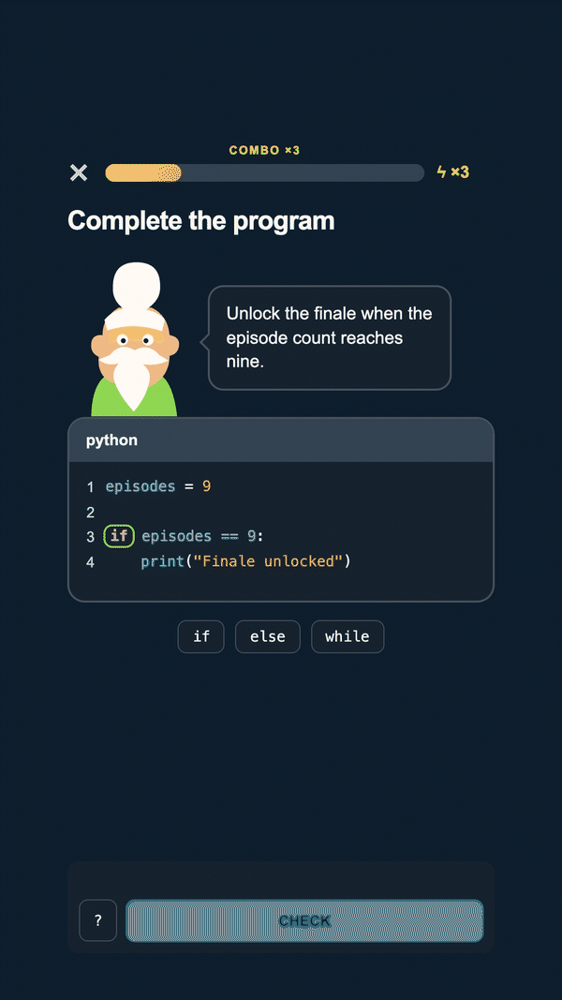
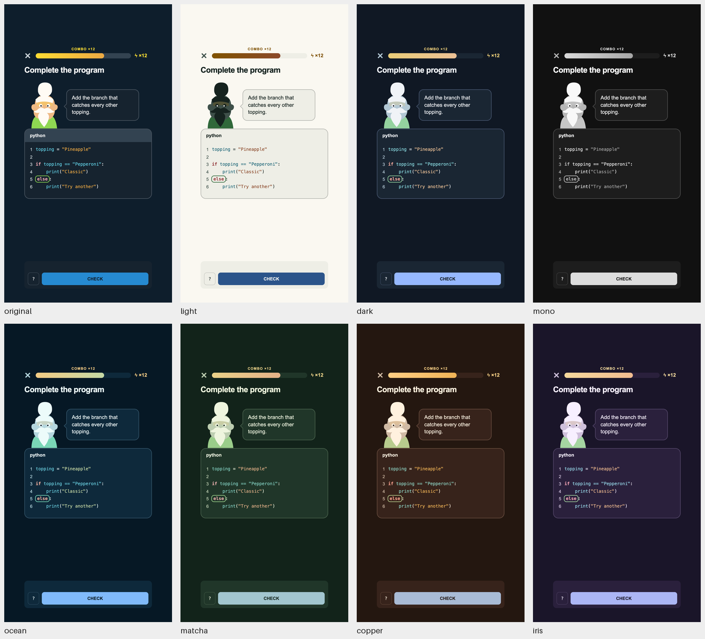

# Midnight code kitchen

A small chef coaches a fill-in-the-blank coding lesson. A golden streak bar, colored answer chips and an inset editor track the exercise.

| | |
| --- | --- |
| **Category** | [Apps › Education](../) |
| **Size** | 576 × 1024 |
| **Colorways** | original, light, dark, mono, ocean, matcha, copper, iris |
| **Fonts** | Arial and Menlo, with system fallbacks. |
| **Artwork** | An original vector chef and a new set of food-themed practice exercises. |
| **Animated** | 6-second loop, 24 fps |
| **Based on** | [A TikTok by @paulcodes4](https://www.tiktok.com/@paulcodes4/video/7710530058544352533) |

## Every colorway

## Files

Open [the design](source/design.html) and add `#ocean` to its address to change the colorway. The [exports](exports/) contain a PNG for every palette, plus a matching MP4.

## Changing it

The CSS variables at the top of the source define the colors. Select an answer and choose Check to work through the exercises. Run `python3 .github/scripts/export_design.py apps/education/midnight-code-kitchen` to regenerate the media.
