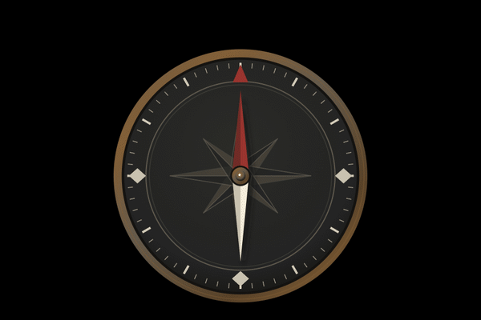
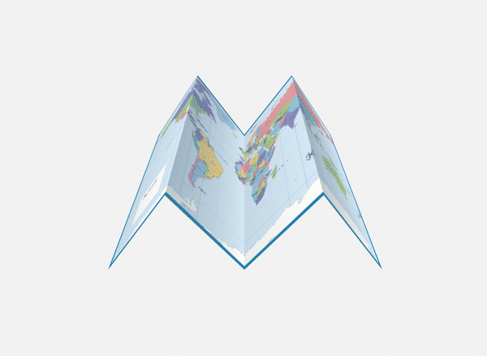

<!-- Generated by .github/scripts/build_catalog.py. Edit that file, not this one. -->
# Maps and navigation

Maps and navigation.

Part of [Apps](../).

## Designs (2)

<table>
<tr><td align="center" valign="top" width="33%"> <a href="brass-pocket-compass/"><b>Brass pocket compass</b></a> 8 colorways</td><td align="center" valign="top" width="33%"> <a href="folded-world-map/"><b>Folded world map</b></a> 8 colorways</td></tr>
</table>

Adding one? See [Adding a design](../../README.md#adding-a-design).
