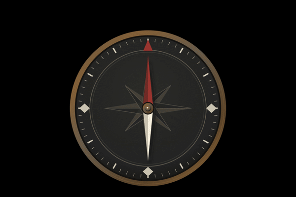
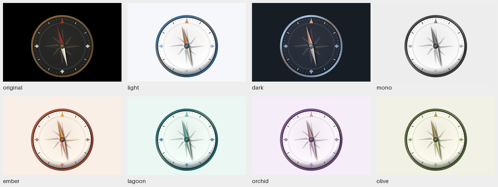

# Brass pocket compass

A beveled brass rim encloses sixty minute ticks, a faint compass rose and a sharply faceted two-color needle on black.

| | |
| --- | --- |
| **Category** | [Apps › Maps & navigation](../) |
| **Size** | 864 × 576 CSS pixels, exported at 2× |
| **Colorways** | original, light, dark, mono, ember, lagoon, orchid, olive |
| **Fonts** | No lettering in the design |
| **Icons** | Original inline SVG and CSS |
| **Animated** | Yes, 3.4-second loop at 24 fps |
| **Based on** | [A TikTok by @paulcodes4](https://www.tiktok.com/@paulcodes4/video/7700127291002703125) |

## Every colorway

## Files

- Open [the design](source/design.html) in a browser and append `#ember` to select that colorway. Add `?t=1#ember` after the filename to show the export still.
- [The exports folder](exports/) contains a PNG and an H.264 MP4 loop for each colorway.

## Changing it

Drag around the dial or use the arrow keys to set a bearing. The animated preview demonstrates the original needle’s quick changes of direction.

The custom properties at the top of `source/design.html` define each palette. Copy a palette block, give it a new colorway name, then run `python3 .github/scripts/export_design.py apps/maps-navigation/brass-pocket-compass` from the repository root.
