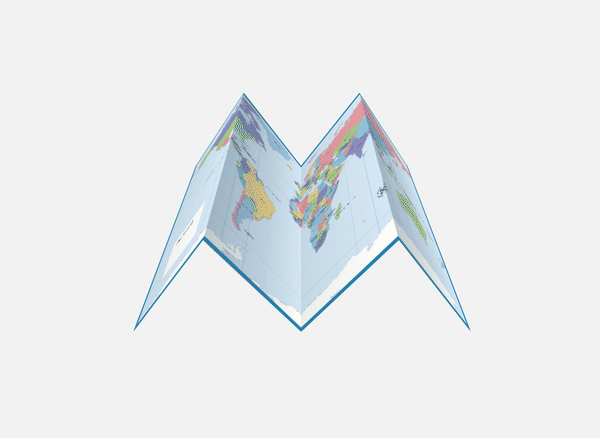
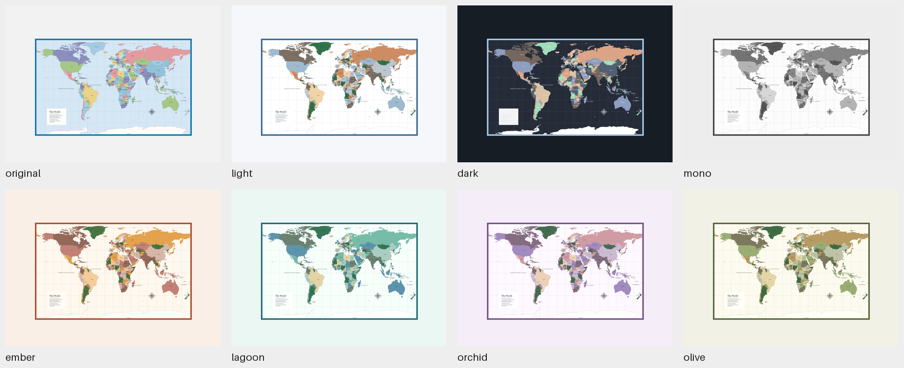

# Folded world map

A political world map opens from four steep accordion folds. Flat ocean blue, colored land areas and a slim blue border change perspective together.

| | |
| --- | --- |
| **Category** | [Apps › Maps & navigation](../) |
| **Size** | 864 × 630 CSS pixels, exported at 2× |
| **Colorways** | original, light, dark, mono, ember, lagoon, orchid, olive |
| **Fonts** | System sans serif for the map and Georgia for its legend |
| **Icons** | Original inline SVG and CSS |
| **Animated** | Yes, 7.8-second loop at 24 fps |
| **Based on** | [A TikTok by @paulcodes4](https://www.tiktok.com/@paulcodes4/video/7691220377615289621) |

## Every colorway

## Files

- Open [the design](source/design.html) in a browser and append `#ember` to select that colorway. Add `?t=1.6#ember` after the filename to show the export still.
- [The exports folder](exports/) contains a PNG and an H.264 MP4 loop for each colorway.

## Changing it

Hover, focus or tap to unfold or refold the map. The vector cartography is an original treatment of Natural Earth public-domain country geometry. [Natural Earth terms of use](https://www.naturalearthdata.com/about/terms-of-use/)

The custom properties at the top of `source/design.html` define each palette. Copy a palette block, give it a new colorway name, then run `python3 .github/scripts/export_design.py apps/maps-navigation/folded-world-map` from the repository root.
