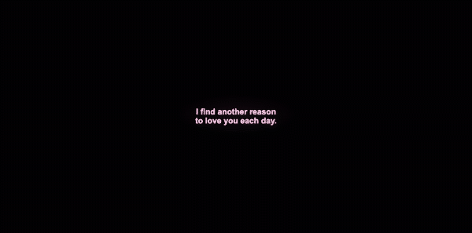
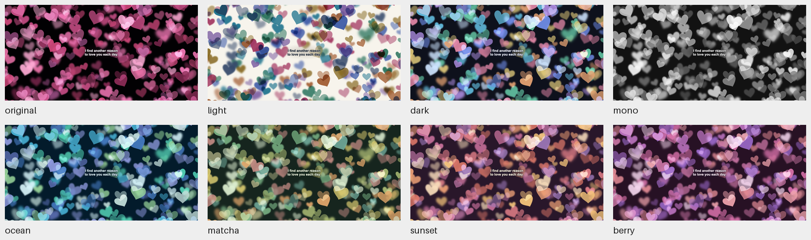

# Floating rose hearts

Pink hearts of different sizes drift upward at several depths around a short, centered love note.

| | |
| --- | --- |
| **Category** | [Backgrounds › Shapes](../) |
| **Size** | 576 × 285 CSS pixels, 2× export |
| **Colorways** | original, light, dark, mono, ocean, matcha, sunset, berry |
| **Fonts** | Arial or the local sans-serif fallback. |
| **Artwork** | Original procedural illustration and SVG geometry, drawn for Motherlode |
| **Animated** | Yes, 5.8-second loop |
| **Based on** | [A TikTok by @paulcodes4](https://www.tiktok.com/@paulcodes4/video/7693073924032171270) |

## Every colorway

## Files

- `source/design.html` is the standalone artwork. Its address accepts a palette such as `#matcha` and a preview time such as `?t=3.9#ocean`.
- `exports/` contains each palette’s PNG still and H.264 loop.

## Changing it

The foreground, middle and distant fields have distinct travel, scale and blur. Edit the two SVG text lines to personalize the note. The colorway blocks at the top of the source define the inks and ground. Run `python3 .github/scripts/export_design.py backgrounds/shapes/floating-rose-hearts` to regenerate the exports.
