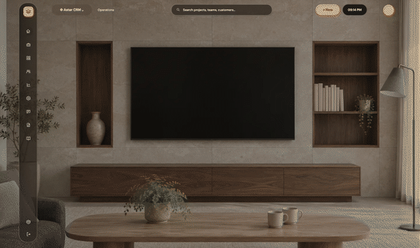
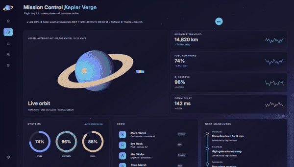
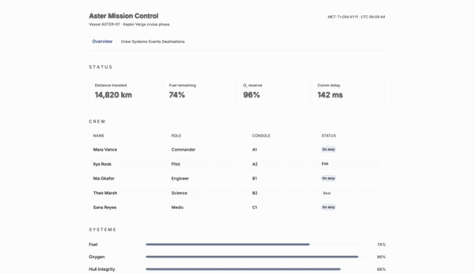

<!-- Generated by .github/scripts/build_catalog.py. Edit that file, not this one. -->
# Analytics

Web and product analytics.

Part of [Dashboards](../).

## Designs (3)

<table>
<tr><td align="center" valign="top" width="33%"> <a href="amber-glass-operations/"><b>Amber glass operations</b></a> 8 colorways</td><td align="center" valign="top" width="33%"> <a href="kepler-orbital-command/"><b>Kepler orbital command console</b></a> 8 colorways</td><td align="center" valign="top" width="33%"> <a href="white-mission-status/"><b>White mission status sheet</b></a> 8 colorways</td></tr>
</table>

Adding one? See [Adding a design](../../README.md#adding-a-design).
