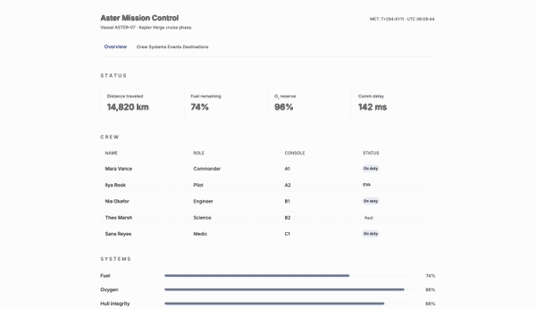
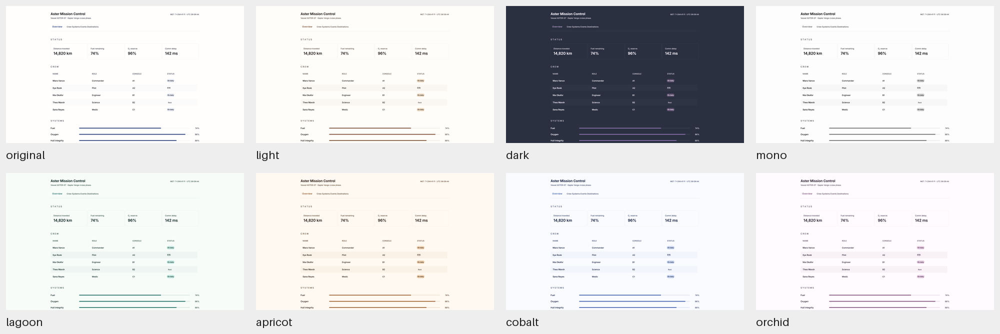

# White mission status sheet

A compact mission status sheet with four flight metrics, crew duty states, system reserves and destination progress. Its opening scroll reveals the first destination.

| | |
| --- | --- |
| **Category** | [Dashboards › Analytics](../) |
| **Size** | 1440 × 830 CSS pixels, exported at 2× |
| **Colorways** | original, light, dark, mono, lagoon, apricot, cobalt, orchid |
| **Fonts** | Inter, bundled under the SIL Open Font License |
| **Icons** | Original inline SVG drawings |
| **Animated** | Yes, 1.875 seconds at 24 fps |
| **Based on** | [A TikTok by @paulcodes4](https://www.tiktok.com/@paulcodes4/video/7698710983757335828) |

## Every colorway

## Files

- `source/design.html` contains the interface, diagrams and animation. Select the mission title to replay the short scroll.
- Append `#lagoon` to select that palette, or `?t=0.1#lagoon` to freeze the overview.
- `exports/` contains a PNG and an H.264 MP4 for each palette.
- `source/fonts/OFL.txt` contains the font license.
- The same post also shows the [Kepler orbital command console](../kepler-orbital-command/). This source follows the opening white dashboard.

## Changing it

Edit the named CSS variables at the top of `source/design.html`. To export a new colorway, duplicate a palette block, give it a new name and run `python3 .github/scripts/export_design.py dashboards/analytics/white-mission-status`.
