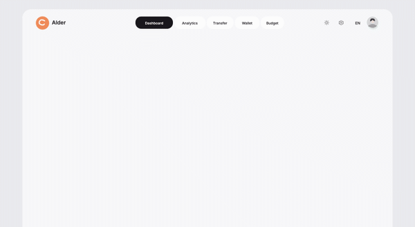
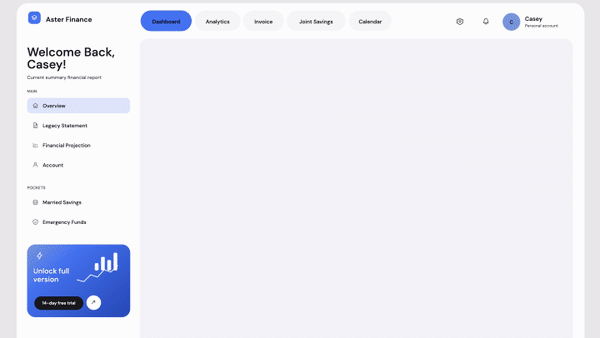
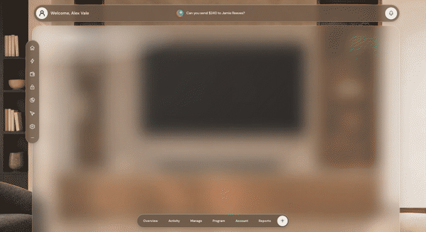

<!-- Generated by .github/scripts/build_catalog.py. Edit that file, not this one. -->
# Banking

Banking and money management.

Part of [Dashboards](../).

## Designs (4)

<table>
<tr><td align="center" valign="top" width="33%"> <a href="apricot-wallet-companion/"><b>Apricot wallet companion</b></a> 8 colorways</td><td align="center" valign="top" width="33%"> <a href="cobalt-joint-savings/"><b>Cobalt joint savings</b></a> 8 colorways</td><td align="center" valign="top" width="33%"> <a href="violet-vault/"><b>Violet vault banking</b></a> 8 colorways</td></tr>
<tr><td align="center" valign="top" width="33%"> <a href="walnut-glass-banking/"><b>Walnut glass banking</b></a> 8 colorways</td></tr>
</table>

Adding one? See [Adding a design](../../README.md#adding-a-design).
