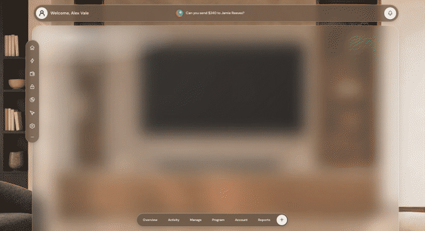
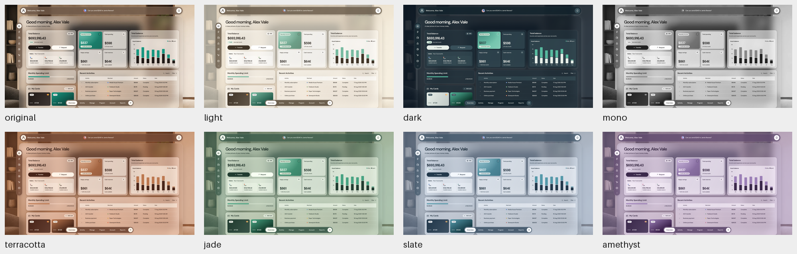

# Walnut glass banking

A translucent personal banking desk over a warm walnut interior. The tour moves from balances and recent activity through savings goals, spending reports and account settings.

| | |
| --- | --- |
| **Category** | [Dashboards › Banking](../) |
| **Size** | 1440 × 784 CSS pixels, exported at 2× |
| **Colorways** | original, light, dark, mono, terracotta, jade, slate, amethyst |
| **Fonts** | DM Sans, bundled Latin variable font under the SIL Open Font License |
| **Icons** | Original inline SVG outlines |
| **Animated** | Yes, 5.5 seconds at 24 fps |
| **Based on** | [A TikTok by @paulcodes4](https://www.tiktok.com/@paulcodes4/video/7700894763297344789) |

## Every colorway

## Files

- Open `source/design.html` in a browser to play the dashboard. Use the home, wallet, report and settings icons to hold a view. Select the welcome avatar to replay. The three automatic savings rules can be toggled in the goals view.
- Append `#terracotta` to the address to switch colorways, or `?t=1.21#terracotta` to freeze a moment.
- `exports/` contains a full-resolution PNG and H.264 MP4 for each colorway.
- `source/fonts/OFL.txt` contains the font license.
- `source/images/` contains an original generated room photograph and its aligned, frosted version.

## Changing it

Edit the CSS variables inside the colorway blocks at the top of `source/design.html`. To add a palette, duplicate a block, give it a new name and regenerate the files with `python3 .github/scripts/export_design.py dashboards/banking/walnut-glass-banking`.
