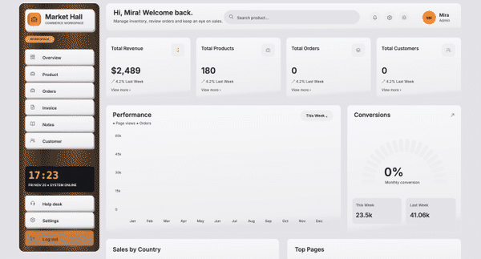

<!-- Generated by .github/scripts/build_catalog.py. Edit that file, not this one. -->
# E-commerce

Store sales and orders.

Part of [Dashboards](../).

## Designs (2)

<table>
<tr><td align="center" valign="top" width="33%"> <a href="indigo-store-desk/"><b>Indigo store desk</b></a> 8 colorways</td><td align="center" valign="top" width="33%"> <a href="walnut-switchboard/"><b>Walnut commerce switchboard</b></a> 8 colorways</td></tr>
</table>

Adding one? See [Adding a design](../../README.md#adding-a-design).
