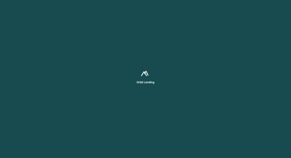
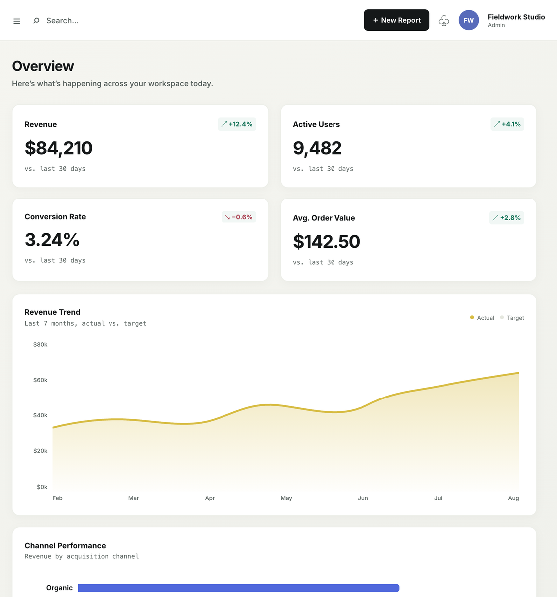

<!-- Generated by .github/scripts/build_catalog.py. Edit that file, not this one. -->
# Finance

Finance and accounting.

Part of [Dashboards](../).

## Designs (2)

<table>
<tr><td align="center" valign="top" width="33%"> <a href="clover-lending-desk/"><b>Clover lending desk</b></a> 8 colorways</td><td align="center" valign="top" width="33%"> <a href="primrose-channel-overview/"><b>Primrose channel overview</b></a> 8 colorways</td></tr>
</table>

Adding one? See [Adding a design](../../README.md#adding-a-design).
