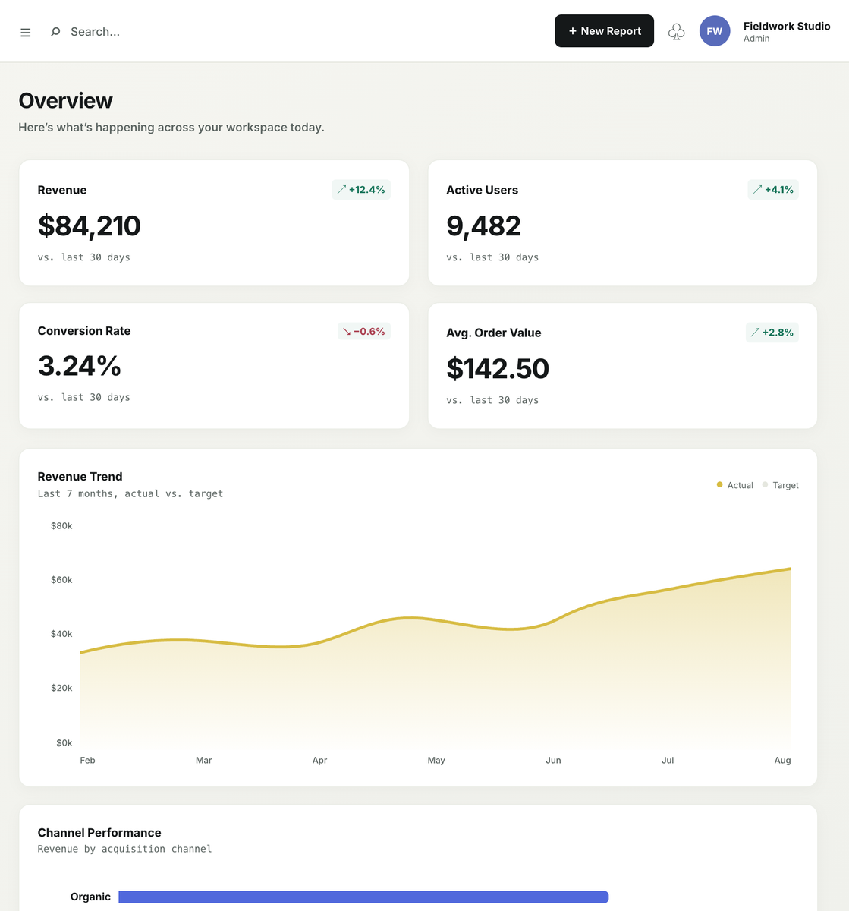
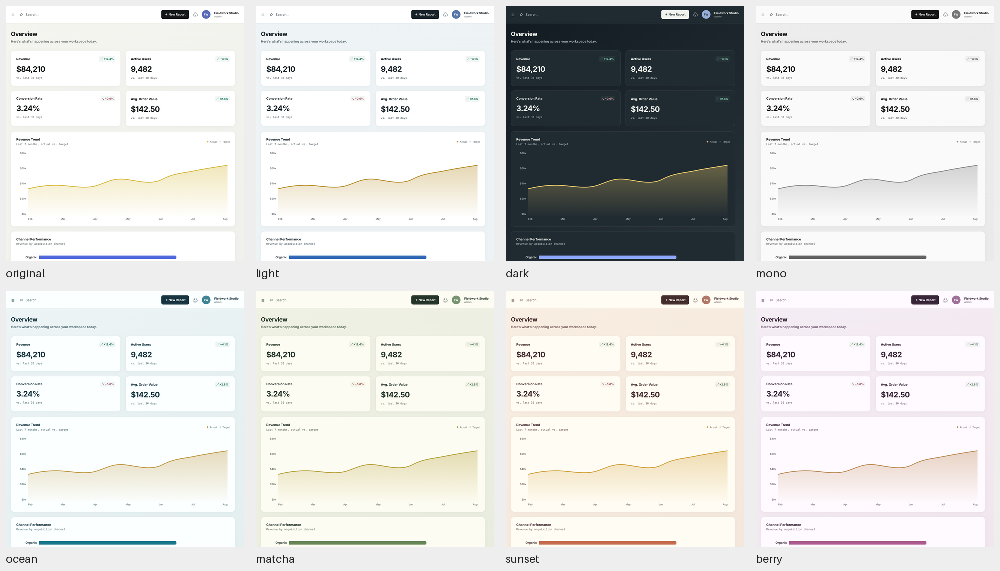

# Primrose channel overview

A light finance dashboard pairs four summary cards with a yellow revenue curve, blue channel bars and a recent activity list. The same layout changes from a single stack on phones to a sidebar and adjacent charts on wide screens.

| | |
| --- | --- |
| **Category** | [Dashboards › Finance](../) |
| **Size** | 880 × 944 CSS pixels, exported at 2× |
| **Colorways** | original, light, dark, mono, ocean, matcha, sunset, berry |
| **Fonts** | Inter, bundled under the SIL Open Font License |
| **Artwork** | Original SVG chart, channel bars, navigation marks and neutral workspace identity. |
| **Animated** | No. The layout adapts to viewport width and supports manual scrolling. |
| **Based on** | [A TikTok by @paulcodes4](https://www.tiktok.com/@paulcodes4/video/7703835429673389332) |

## Every colorway

## Files

- [Open the standalone design](source/design.html). Resize the viewport to see the phone, medium-screen and wide layouts. Scroll to the lower charts and activity list, or use the navigation and search.
- Add `#ocean` to switch palettes.
- [Exports](exports/) holds a PNG for each colorway.

## Changing it

Edit the palette variables at the top of [the source](source/design.html), then run `python3 .github/scripts/export_design.py dashboards/finance/primrose-channel-overview` from the repository root.
