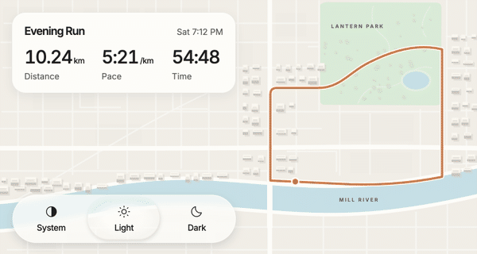
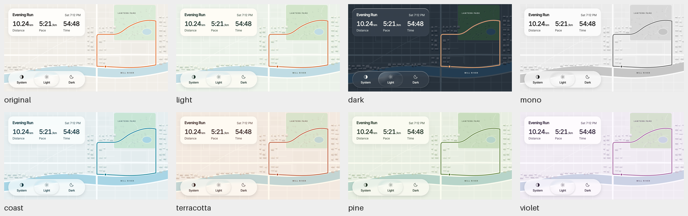

# Evening route map

A riverside run loops around a pocket park. A frosted mode switch darkens the map from its point of contact as streetlights come on along the route.

| | |
| --- | --- |
| **Category** | [Dashboards › Fitness](../) |
| **Size** | 900 × 480 CSS pixels, exported at 2× |
| **Colorways** | original, light, dark, mono, coast, terracotta, pine, violet |
| **Fonts** | Inter (bundled Latin subset from Google Fonts, SIL Open Font License) |
| **Icons** | Original inline SVG and CSS |
| **Animated** | Yes, 5-second loop at 24 fps |
| **Based on** | [A TikTok by @charles.unemployed](https://www.tiktok.com/@charles.unemployed/video/7706565502264413461) |

## Every colorway

## Files

- Open [the design](source/design.html) in a browser and append `#coast` to select that colorway. Add `?t=0.4#coast` after the filename to show the export still.
- [The exports folder](exports/) contains a PNG and an H.264 MP4 loop for each colorway.
- [The font folder](source/fonts/) includes the font files and their licenses.

## Changing it

Tap System, Light or Dark, or drag the glass between options to scrub the dusk transition. System follows the browser’s color preference. The exported loop demonstrates both day and night. The map, fictitious streets, buildings, route and lights are original vector artwork.

The custom properties at the top of `source/design.html` define each palette. Copy a palette block, give it a new colorway name, then run `python3 .github/scripts/export_design.py dashboards/fitness/evening-route-map` from the repository root.

The metrics use tabular figures so changing numbers stay aligned. The raised theme control keeps a bright upper edge in the night palette. [Typography and optical alignment by @charles.unemployed](https://www.tiktok.com/@charles.unemployed/video/7706223781462674740) · [Surface and border examples by @charles.unemployed](https://www.tiktok.com/@charles.unemployed/video/7708439548958723348)
