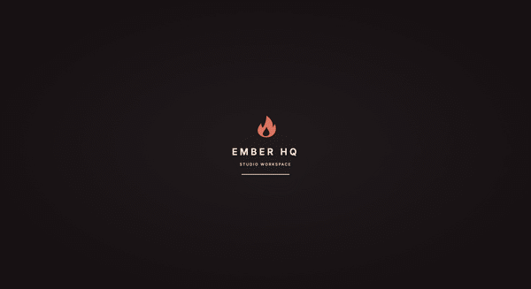
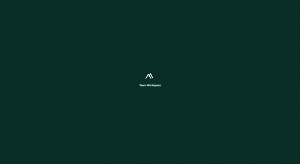
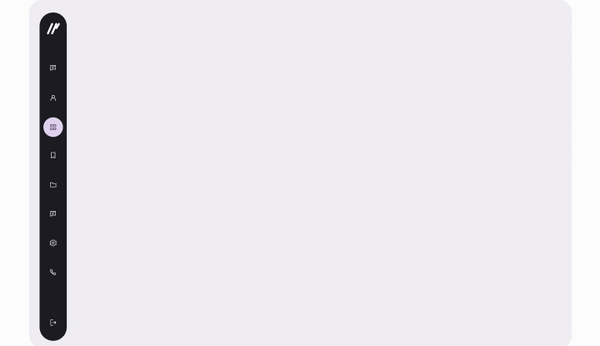

<!-- Generated by .github/scripts/build_catalog.py. Edit that file, not this one. -->
# Project management

Projects, tasks and sprints.

Part of [Dashboards](../).

## Designs (3)

<table>
<tr><td align="center" valign="top" width="33%"> <a href="ember-studio-workspace/"><b>Ember studio workspace</b></a> 8 colorways</td><td align="center" valign="top" width="33%"> <a href="evergreen-team-studio/"><b>Evergreen team studio</b></a> 8 colorways</td><td align="center" valign="top" width="33%"> <a href="lilac-team-room/"><b>Lilac team room</b></a> 8 colorways</td></tr>
</table>

Adding one? See [Adding a design](../../README.md#adding-a-design).
