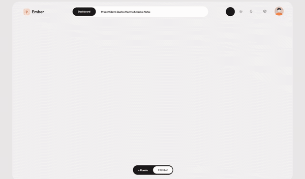
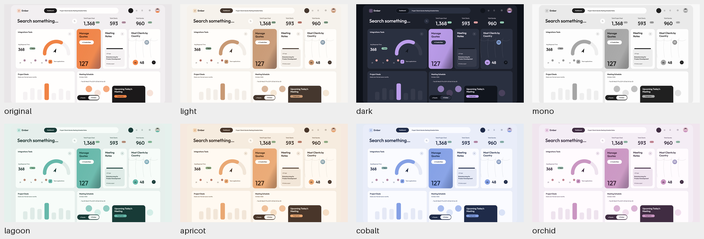

# Ember meeting desk

An orange and cream project workspace puts a response-time gauge beside quotes, meeting notes and a client map. Deal volume and a weekly meeting schedule fill the lower row.

| | |
| --- | --- |
| **Category** | [Dashboards › Project management](../) |
| **Size** | 1440 × 846 CSS pixels, exported at 2× |
| **Colorways** | original, light, dark, mono, lagoon, apricot, cobalt, orchid |
| **Fonts** | Outfit, bundled under the SIL Open Font License |
| **Icons** | Original inline SVG drawings |
| **Animated** | Yes, 2.125 seconds at 24 fps |
| **Based on** | [A TikTok by @paulcodes4](https://www.tiktok.com/@paulcodes4/video/7701233556487490836) |

## Every colorway

## Files

- `source/design.html` contains the interface, diagrams and animation. Select the workspace mark to replay the dashboard.
- Append `#lagoon` to select that palette, or `?t=1.6#lagoon` to freeze the overview.
- `exports/` contains a PNG and an H.264 MP4 for each palette.
- `source/fonts/OFL.txt` contains the font license.
- The same post also shows the [Pastel language studio](../../education/pastel-language-studio/). This loop follows the orange project workspace.

## Changing it

Edit the named CSS variables at the top of `source/design.html`. To export a new colorway, duplicate a palette block, give it a new name and run `python3 .github/scripts/export_design.py dashboards/project-management/ember-meeting-desk`.
