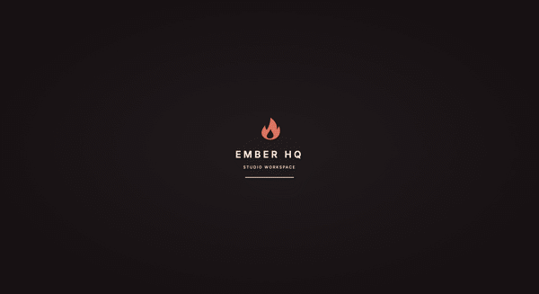
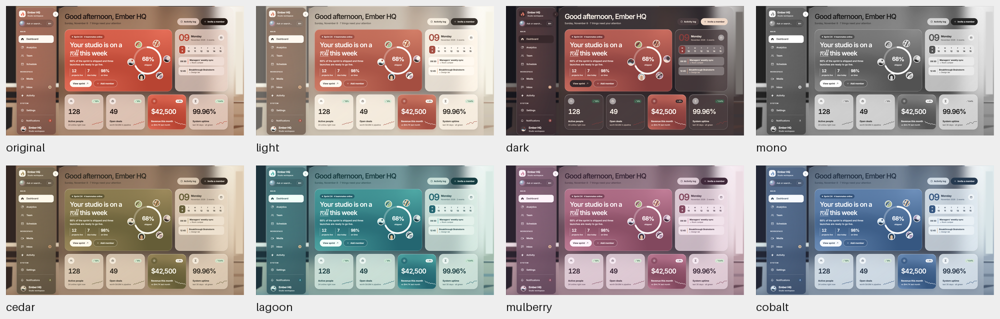

# Ember studio workspace

A coral glass studio dashboard brings sprint progress, a weekly calendar and four live counters into one workspace. Its expanding rail leads to a separate revenue view.

| | |
| --- | --- |
| **Category** | [Dashboards › Project management](../) |
| **Size** | 1152 × 628 CSS pixels, exported at 2× |
| **Colorways** | original, light, dark, mono, cedar, lagoon, mulberry, cobalt |
| **Fonts** | Inter and Instrument Serif (bundled Latin subsets from Google Fonts, SIL Open Font License) |
| **Icons** | Original inline SVG and CSS |
| **Animated** | Yes, 6-second loop at 24 fps |
| **Based on** | [A TikTok by @paulcodes4](https://www.tiktok.com/@paulcodes4/video/7706115811123006740) |

## Every colorway

## Files

- Open [the design](source/design.html) in a browser and append `#cedar` to select that colorway. Add `?t=3.12#cedar` after the filename to show the export still.
- [The exports folder](exports/) contains a PNG and an H.264 MP4 loop for each colorway.
- [The font folder](source/fonts/) includes the font files and their licenses.

## Changing it

The loop opens the workspace, expands the rail, scrolls into the action grid and revenue panels, and switches to Analytics. Click or scroll to take over. The rail toggle, Dashboard and Analytics tabs, calendar dates, report period, task details and local CSV download work in the browser. Press Escape to close a detail, or use Replay from the studio identity at the bottom of the rail. The clip ends while the Analytics chart is entering. Its completed curves use illustrative figures. The architectural backdrop, abstract team medallions, charts and marks are original vector artwork.

The custom properties at the top of `source/design.html` define each palette. Copy a palette block, give it a new colorway name, then run `python3 .github/scripts/export_design.py dashboards/project-management/ember-studio-workspace` from the repository root.
