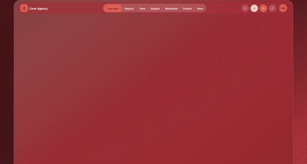
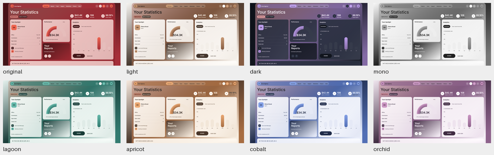

# Garnet agency console

A garnet glass agency dashboard combines an agent spotlight, performance dial, sales reports and property moderation. The finance view reflows into two columns as its notification drawer opens.

| | |
| --- | --- |
| **Category** | [Dashboards › Real Estate](../) |
| **Size** | 1440 × 768 CSS pixels, exported at 2× |
| **Colorways** | original, light, dark, mono, lagoon, apricot, cobalt, orchid |
| **Fonts** | Inter, bundled under the SIL Open Font License |
| **Icons** | Original inline SVG drawings |
| **Animated** | Yes, 5.7083333333 seconds at 24 fps |
| **Based on** | [A TikTok by @paulcodes4](https://www.tiktok.com/@paulcodes4/video/7704993310842309908) |

## Every colorway

## Files

- `source/design.html` contains the interface, diagrams and animation. Use the highlighted navigation entries to hold a view, and select the workspace mark to replay.
- Append `#lagoon` to select that palette, or `?t=1.35#lagoon` to freeze the overview.
- `exports/` contains a PNG and an H.264 MP4 for each palette.
- `source/fonts/OFL.txt` contains the font license.
- `source/images/` contains six original generated architectural photographs of fictional properties.

## Changing it

Edit the named CSS variables at the top of `source/design.html`. To export a new colorway, duplicate a palette block, give it a new name and run `python3 .github/scripts/export_design.py dashboards/real-estate/garnet-agency`.
