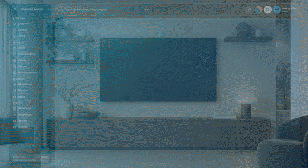
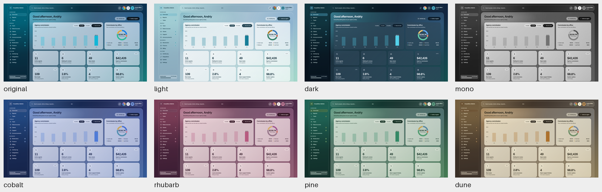

# Tidal agency console

A sea-glass real-estate console with office commissions, agent payouts, a six-property moderation queue and agency announcements.

| | |
| --- | --- |
| **Category** | [Dashboards › Real estate](../) |
| **Size** | 1440 × 784 CSS pixels, exported at 2× |
| **Colorways** | original, light, dark, mono, cobalt, rhubarb, pine, dune |
| **Fonts** | Inter, bundled Latin variable font under the SIL Open Font License |
| **Icons** | Original inline SVG outlines |
| **Animated** | Yes, 5.625 seconds at 24 fps |
| **Based on** | [A TikTok by @paulcodes4](https://www.tiktok.com/@paulcodes4/video/7704385121754926357) |

## Every colorway

## Files

- Open `source/design.html` in a browser to play the dashboard. Select Overview, Finance, Moderation or Announcements in the left navigation to hold that view. Select the agency mark to replay.
- Append `#cobalt` to the address to switch colorways, or `?t=1.43#cobalt` to freeze a moment.
- `exports/` contains a full-resolution PNG and H.264 MP4 for each colorway.
- `source/fonts/OFL.txt` contains the font license.
- `source/images/` contains original generated architectural photographs of fictional properties and an office backdrop.

## Changing it

Edit the CSS variables inside the colorway blocks at the top of `source/design.html`. To add a palette, duplicate a block, give it a new name and regenerate the files with `python3 .github/scripts/export_design.py dashboards/real-estate/tidal-agency`.
