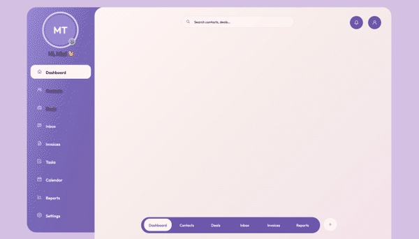
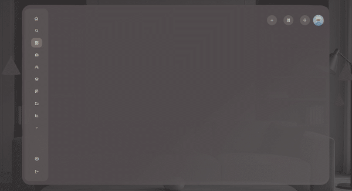
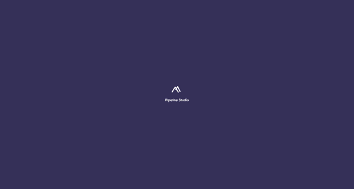

<!-- Generated by .github/scripts/build_catalog.py. Edit that file, not this one. -->
# Sales and CRM

Sales pipelines and CRMs.

Part of [Dashboards](../).

## Designs (9)

<table>
<tr><td align="center" valign="top" width="33%"> <a href="blue-glass-messaging/"><b>Blue glass messaging studio</b></a> 8 colorways</td><td align="center" valign="top" width="33%"> <a href="citron-sales-ledger/"><b>Citron sales ledger</b></a> 8 colorways</td><td align="center" valign="top" width="33%"> <a href="coral-pipeline/"><b>Coral pipeline workspace</b></a> 8 colorways</td></tr>
<tr><td align="center" valign="top" width="33%"> <a href="honey-glass-deal-room/"><b>Honey glass deal room</b></a> 8 colorways</td><td align="center" valign="top" width="33%"> <a href="lilac-clay-pipeline/"><b>Lilac clay pipeline</b></a> 8 colorways</td><td align="center" valign="top" width="33%"> <a href="pendant-glass-workspace/"><b>Pendant glass workspace</b></a> 8 colorways</td></tr>
<tr><td align="center" valign="top" width="33%"> <a href="smoked-glass-deal-room/"><b>Smoked glass deal room</b></a> 8 colorways</td><td align="center" valign="top" width="33%"> <a href="violet-ribbon-sales/"><b>Violet ribbon sales desk</b></a> 8 colorways</td><td align="center" valign="top" width="33%"> <a href="walnut-glass-pipeline/"><b>Walnut glass sales pipeline</b></a> 8 colorways</td></tr>
</table>

Adding one? See [Adding a design](../../README.md#adding-a-design).
