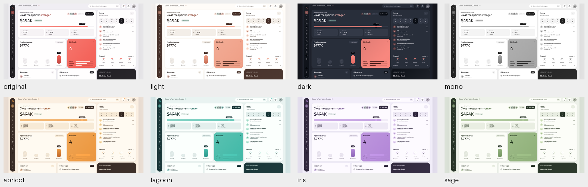

# Coral pipeline workspace

A coral sales workspace with a quarterly revenue target, pipeline chart, calendar, saved deal library, task board and client conversation.

| | |
| --- | --- |
| **Category** | [Dashboards › Sales and CRM](../) |
| **Size** | 1440 × 784 CSS pixels, exported at 2× |
| **Colorways** | original, light, dark, mono, apricot, lagoon, iris, sage |
| **Fonts** | Outfit, bundled Latin variable font under the SIL Open Font License |
| **Icons** | Original inline SVG outlines |
| **Animated** | Yes, 5.75 seconds at 24 fps |
| **Based on** | [A TikTok by @paulcodes4](https://www.tiktok.com/@paulcodes4/video/7707649957687250197) |

## Every colorway

## Files

- Open `source/design.html` in a browser to play the dashboard. Use the dashboard, bookmark, task and message icons in the left rail to hold a view. Select the emblem to replay the tour.
- Append `#apricot` to the address to switch colorways, or `?t=1.28#apricot` to freeze a moment.
- `exports/` contains a full-resolution PNG and H.264 MP4 for each colorway.
- `source/fonts/OFL.txt` contains the font license.

## Changing it

Edit the CSS variables inside the colorway blocks at the top of `source/design.html`. To add a palette, duplicate a block, give it a new name and regenerate the files with `python3 .github/scripts/export_design.py dashboards/sales-crm/coral-pipeline`.
