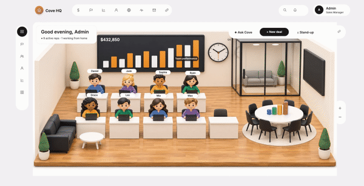
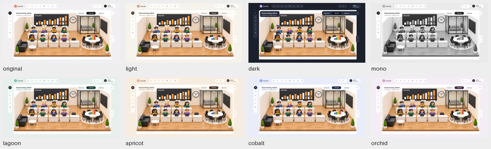

# Miniature sales office

An interactive miniature sales floor with individual desks and a circular meeting table. The camera moves in to inspect a rep, returns for the assistant drawer and then approaches the stand-up meeting.

| | |
| --- | --- |
| **Category** | [Dashboards › Sales and CRM](../) |
| **Size** | 1440 × 736 CSS pixels, exported at 2× |
| **Colorways** | original, light, dark, mono, lagoon, apricot, cobalt, orchid |
| **Fonts** | Inter, bundled under the SIL Open Font License |
| **Icons** | Original inline SVG drawings |
| **Animated** | Yes, 6.875 seconds at 24 fps |
| **Based on** | [A TikTok by @paulcodes4](https://www.tiktok.com/@paulcodes4/video/7701235399334661396) |

## Every colorway

## Files

- `source/design.html` contains the interface, diagrams and animation. Select a rep, use the zoom controls, open the sales assistant or choose Stand-up to hold the corresponding view. Select Cove HQ to replay.
- Append `#lagoon` to select that palette, or `?t=0.49#lagoon` to freeze the overview.
- `exports/` contains a PNG and an H.264 MP4 for each palette.
- `source/fonts/OFL.txt` contains the font license.
- `source/images/sales-floor.webp` is an original generated diorama of fictional office figures, desks and meeting furniture.

## Changing it

Edit the named CSS variables at the top of `source/design.html`. To export a new colorway, duplicate a palette block, give it a new name and run `python3 .github/scripts/export_design.py dashboards/sales-crm/miniature-sales-office`.
