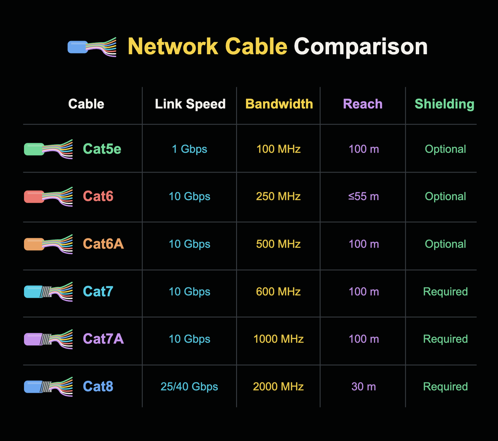
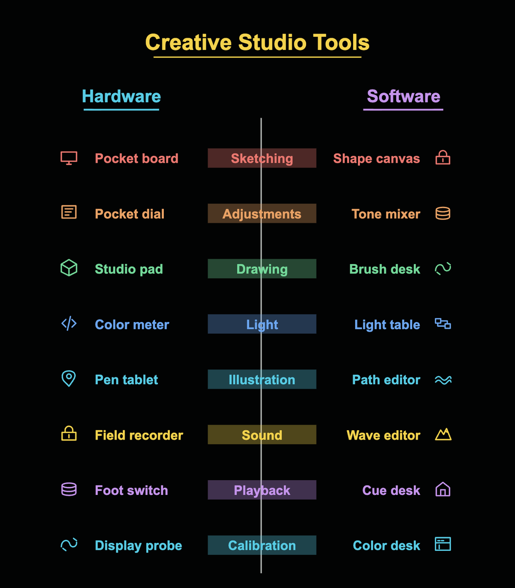

<!-- Generated by .github/scripts/build_catalog.py. Edit that file, not this one. -->
# Comparison tables

Comparison tables.

Part of [Data](../).

## Designs (2)

<table>
<tr><td align="center" valign="top" width="33%"> <a href="cable-spectrum-table/"><b>Cable spectrum table</b></a> 8 colorways</td><td align="center" valign="top" width="33%"> <a href="studio-tool-pairings/"><b>Studio tool pairings</b></a> 8 colorways</td></tr>
</table>

Adding one? See [Adding a design](../../README.md#adding-a-design).
