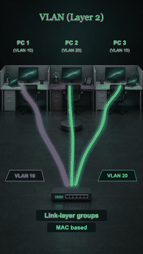
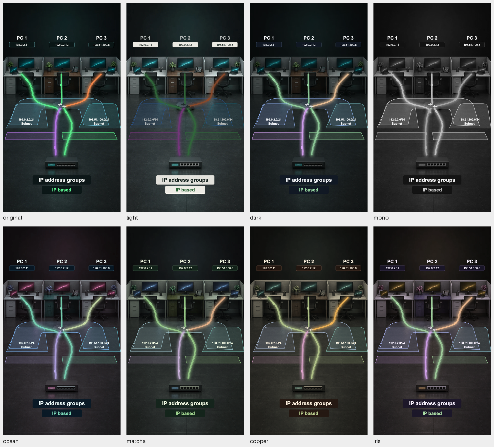

# Layered network workstations

Three office desks connect to a shared switch through luminous colored network paths. The diagram alternates between link-layer and network-layer views.

| | |
| --- | --- |
| **Category** | [Data › Diagrams](../) |
| **Size** | 576 × 1024 |
| **Colorways** | original, light, dark, mono, ocean, matcha, copper, iris |
| **Fonts** | Arial and system sans-serif. |
| **Artwork** | Original generated workstation photograph, editable overlay paths, labels and packet motion. |
| **Animated** | 10-second loop, 24 fps |
| **Based on** | [A TikTok by @paulcodes4](https://www.tiktok.com/@paulcodes4/video/7693145052322778389) |

## Every colorway

## Files

Open [the design](source/design.html) and add `#ocean` to its address to change the colorway. The [exports](exports/) contain a PNG for every palette, plus a matching MP4.

## Changing it

The CSS variables at the top of the source define the colors. Run `python3 .github/scripts/export_design.py data/diagrams/layered-network-workstations` to regenerate the media.
