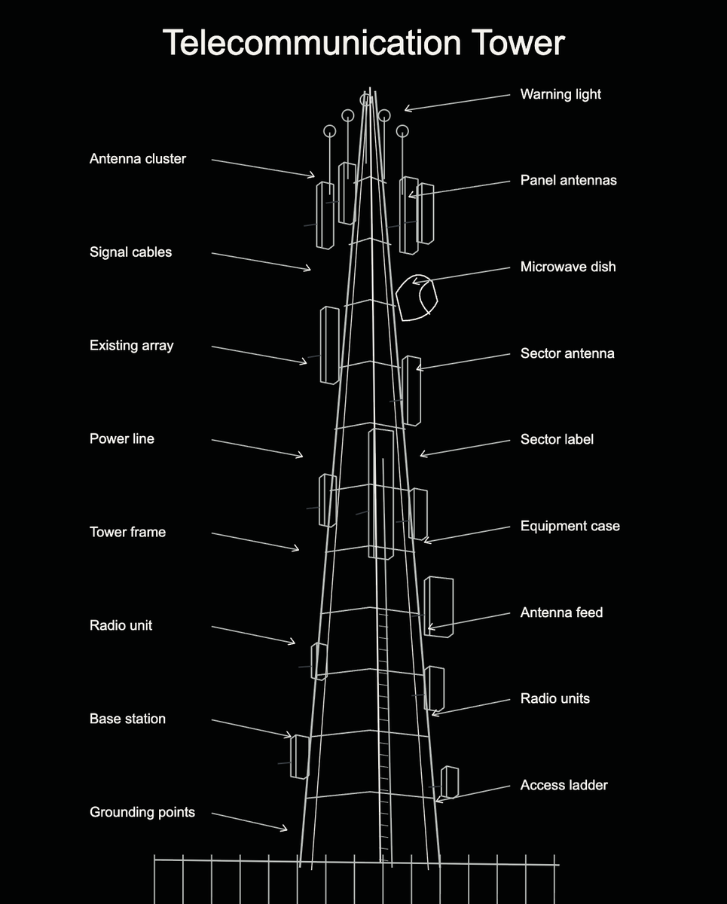
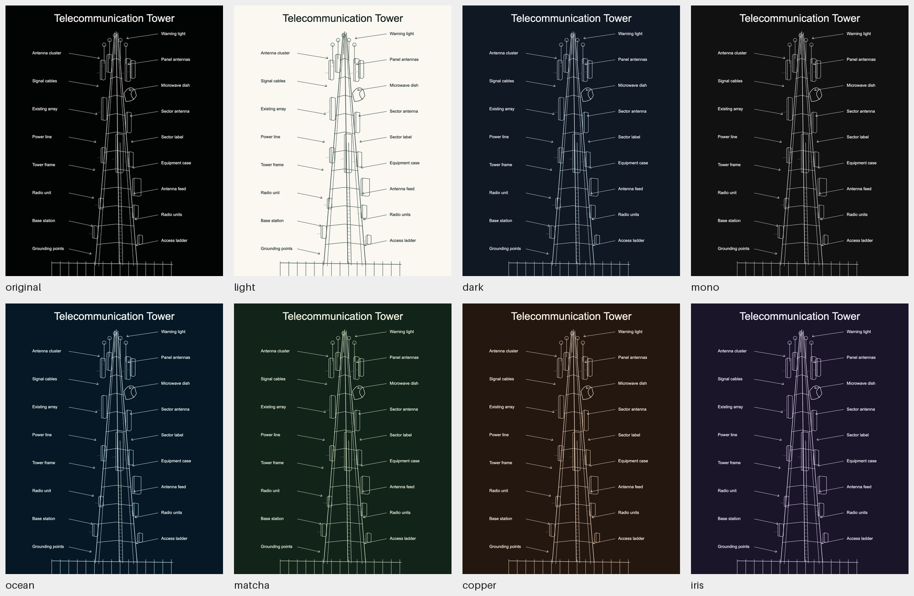

# Mast linework study

A fine white wire drawing rises through a black field, with two narrow columns of aligned component labels.

| | |
| --- | --- |
| **Category** | [Data › Diagrams](../) |
| **Size** | 1184 × 1472 |
| **Colorways** | original, light, dark, mono, ocean, matcha, copper, iris |
| **Fonts** | Arial (system sans-serif) |
| **Artwork** | Original vector mast, equipment, connectors and leader lines |
| **Animated** | No |
| **Based on** | [A TikTok by @paulcodes4](https://www.tiktok.com/@paulcodes4/photo/7702720459330063637) |

## Every colorway

## Files

Open [the editable design](source/design.html) and append a colorway such as `#ocean` to its address. The [exports](exports/) contain the full-size PNGs.

## Changing it

The color blocks in the HTML control the palette. The type, placement and artwork are editable in the SVG. Run `python3 .github/scripts/export_design.py data/diagrams/mast-linework-study` after making a change.
