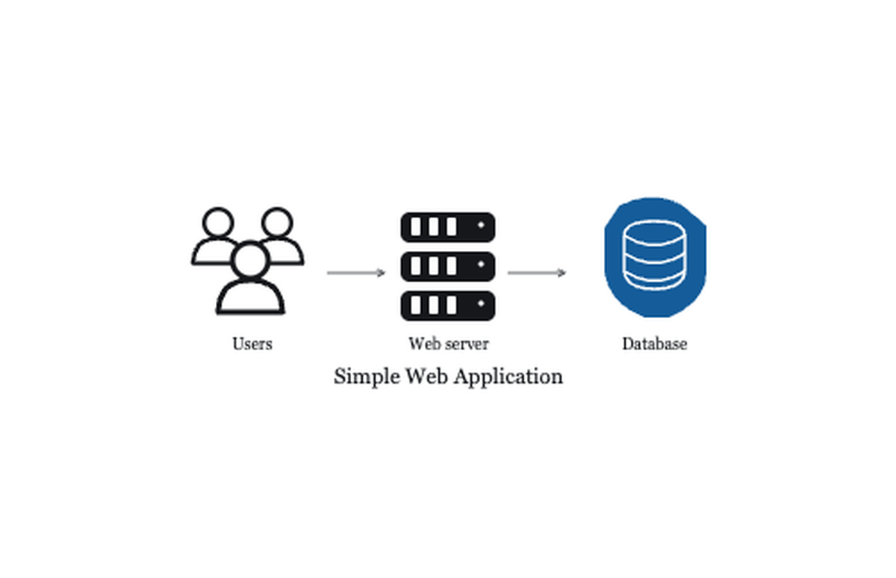
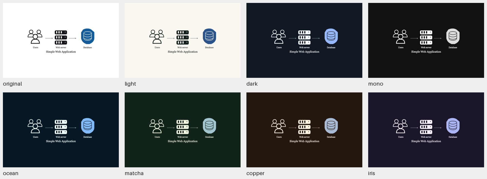

# Three-node web stack

A compact row of people, servers and storage shows how a web application connects, centered on a white landscape canvas.

| | |
| --- | --- |
| **Category** | [Data › Diagrams](../) |
| **Size** | 501 × 324 |
| **Colorways** | original, light, dark, mono, ocean, matcha, copper, iris |
| **Fonts** | Georgia, system serif. |
| **Artwork** | Original vector users, server stack and blue database badge. |
| **Animated** | No |
| **Based on** | [A TikTok by @paulcodes4](https://www.tiktok.com/@paulcodes4/video/7694359422956522772) |

## Every colorway

## Files

Open [the design](source/design.html) and add `#ocean` to its address to change the colorway. The [exports](exports/) contain a PNG for every palette.

## Changing it

The CSS variables at the top of the source define the colors. Run `python3 .github/scripts/export_design.py data/diagrams/three-node-web-stack` to regenerate the media.
