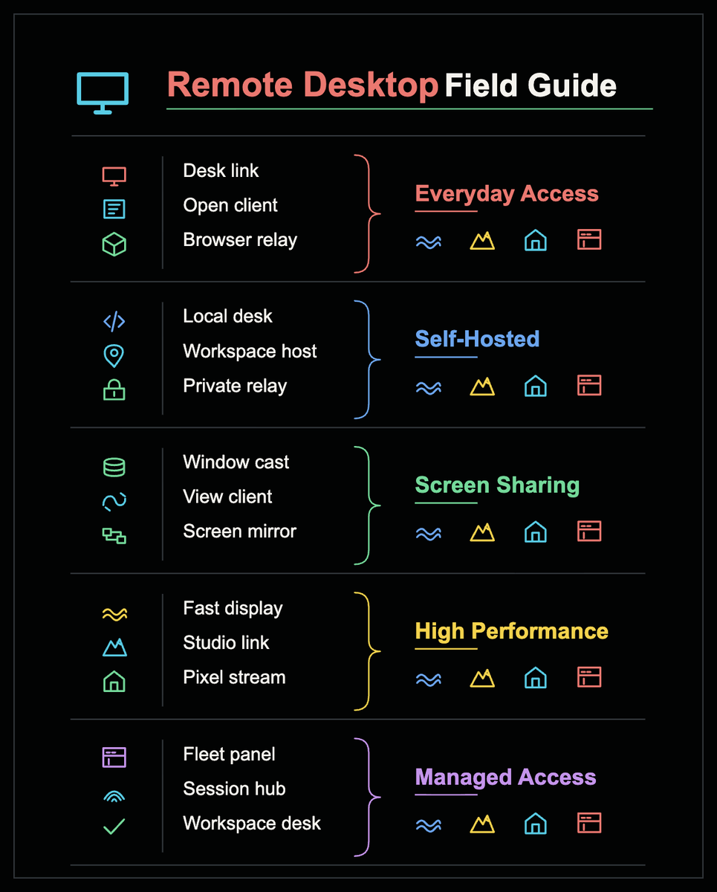
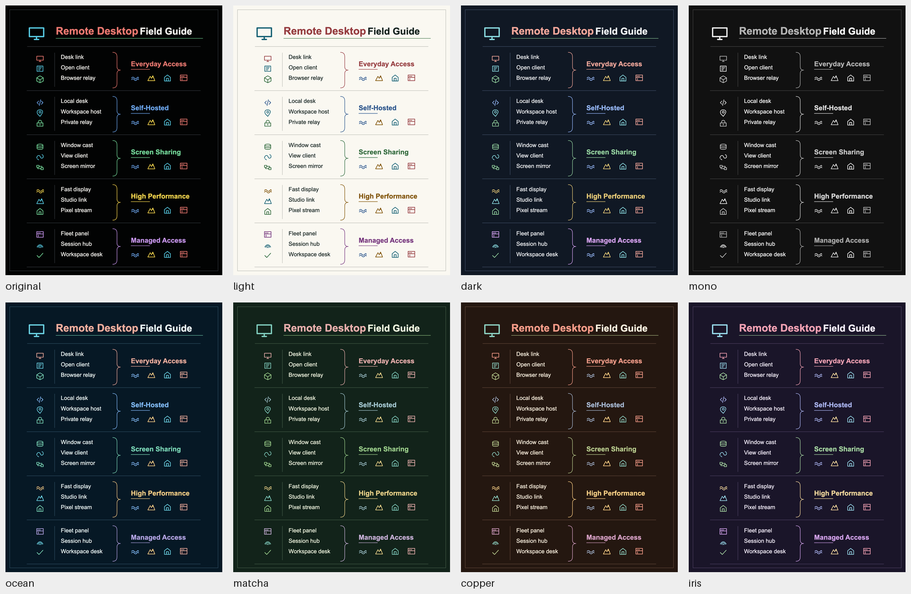

# Remote desktop field guide

Five bands of icons, text and colored braces organize a dark reference sheet for remote desktop interfaces.

| | |
| --- | --- |
| **Category** | [Data › Infographics](../) |
| **Size** | 1184 × 1472 |
| **Colorways** | original, light, dark, mono, ocean, matcha, copper, iris |
| **Fonts** | Arial (system sans-serif) |
| **Artwork** | Illustrative software names and original symbols replace third-party logos |
| **Animated** | No |
| **Based on** | [A TikTok by @paulcodes4](https://www.tiktok.com/@paulcodes4/photo/7701026964873678100) |

## Every colorway

## Files

Open [the editable design](source/design.html) and append a colorway such as `#ocean` to its address. The [exports](exports/) contain the full-size PNGs.

## Changing it

The color blocks in the HTML control the palette. The type, placement and artwork are editable in the SVG. Run `python3 .github/scripts/export_design.py data/infographics/remote-desktop-field-guide` after making a change.
