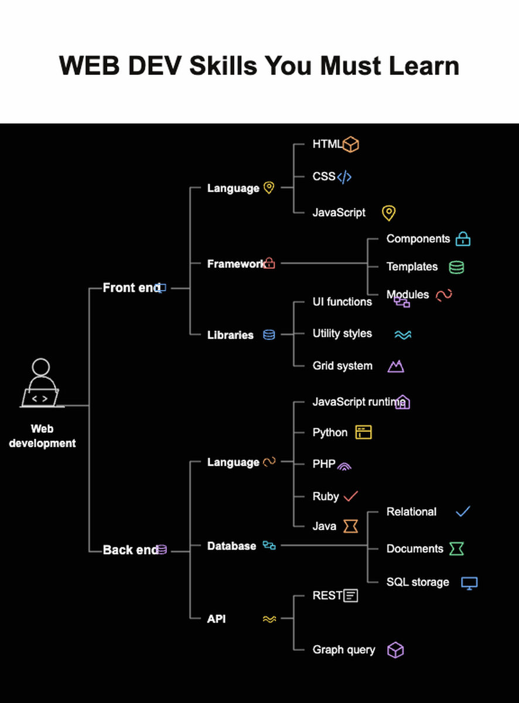
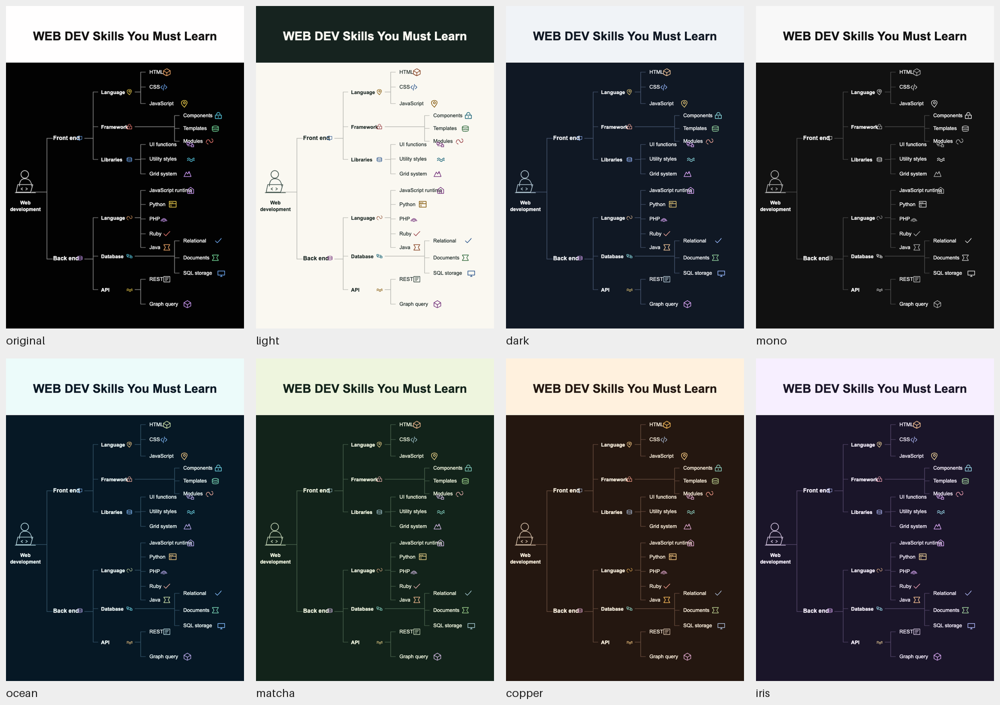

# Front and back skills tree

A fine gray tree branches from a developer at a desk into five skill families. A white headline strip anchors the black diagram.

| | |
| --- | --- |
| **Category** | [Data › Mind Maps](../) |
| **Size** | 576 × 780 |
| **Colorways** | original, light, dark, mono, ocean, matcha, copper, iris |
| **Fonts** | Arial, system sans-serif. |
| **Artwork** | Original line drawings and small, color-coded symbols for the technologies. |
| **Animated** | No |
| **Based on** | [A TikTok by @paulcodes4](https://www.tiktok.com/@paulcodes4/video/7700165783590046997) |

## Every colorway

## Files

Open [the design](source/design.html) and add `#ocean` to its address to change the colorway. The [exports](exports/) contain a PNG for every palette.

## Changing it

The CSS variables at the top of the source define the colors. Run `python3 .github/scripts/export_design.py data/mind-maps/front-and-back-skills-tree` to regenerate the media.
