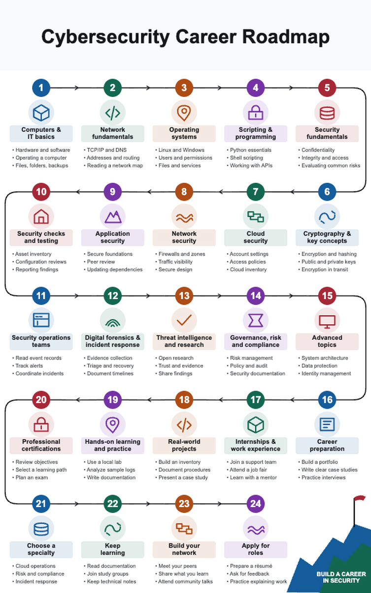
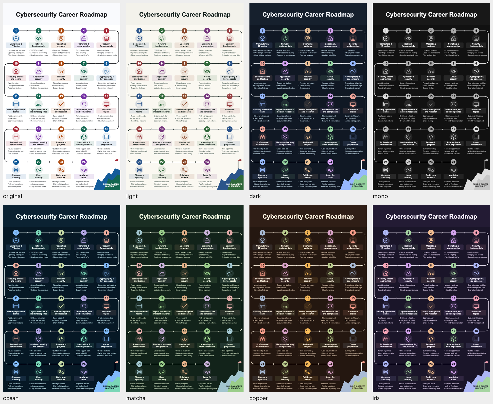

# Five-column career trail

Twenty-four career milestones wind across a white sheet. Each numbered node has a colored pictogram, a tinted title and a short checklist.

| | |
| --- | --- |
| **Category** | [Data › Roadmaps](../) |
| **Size** | 576 × 918 |
| **Colorways** | original, light, dark, mono, ocean, matcha, copper, iris |
| **Fonts** | Arial, system sans-serif. |
| **Artwork** | Original career pictograms and a defensive security curriculum. |
| **Animated** | No |
| **Based on** | [A TikTok by @paulcodes4](https://www.tiktok.com/@paulcodes4/video/7705328611485830421) |

## Every colorway

## Files

Open [the design](source/design.html) and add `#ocean` to its address to change the colorway. The [exports](exports/) contain a PNG for every palette.

## Changing it

The CSS variables at the top of the source define the colors. Run `python3 .github/scripts/export_design.py data/roadmaps/five-column-career-trail` to regenerate the media.
