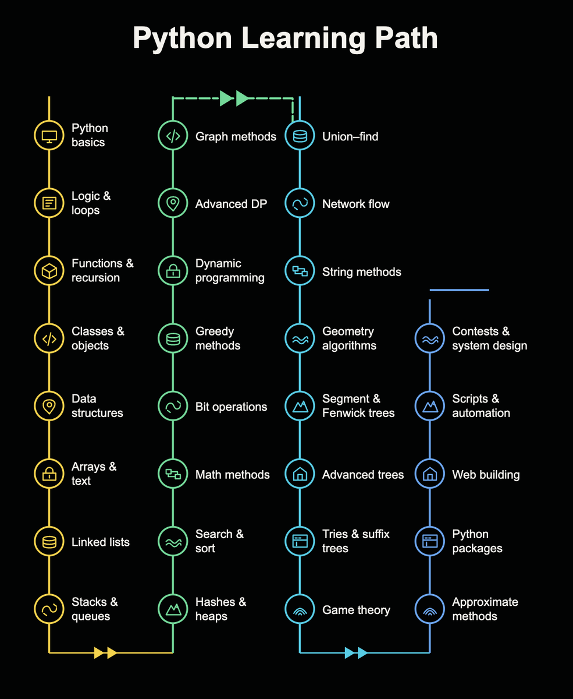
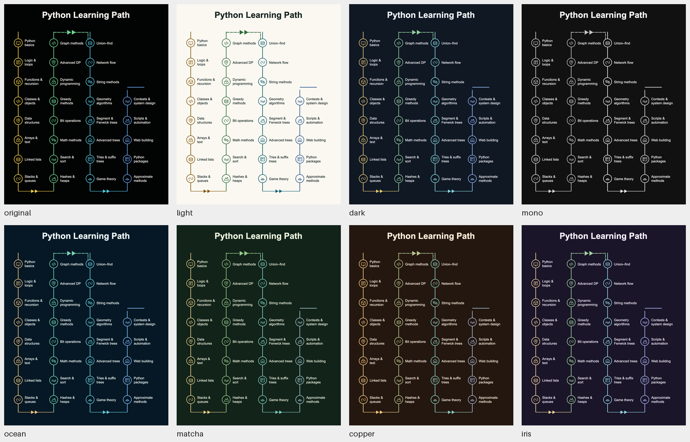

# Four-column learning path

Four colored rails wind through a learning map. Each small outlined node carries an original glyph and a short topic label.

| | |
| --- | --- |
| **Category** | [Data › Roadmaps](../) |
| **Size** | 1208 × 1472 |
| **Colorways** | original, light, dark, mono, ocean, matcha, copper, iris |
| **Fonts** | Arial (system sans-serif) |
| **Artwork** | Original vector symbols and a four-column editable roadmap |
| **Animated** | No |
| **Based on** | [A TikTok by @paulcodes4](https://www.tiktok.com/@paulcodes4/photo/7692084775884049684) |

## Every colorway

## Files

Open [the editable design](source/design.html) and append a colorway such as `#ocean` to its address. The [exports](exports/) contain the full-size PNGs.

## Changing it

The color blocks in the HTML control the palette. The type, placement and artwork are editable in the SVG. Run `python3 .github/scripts/export_design.py data/roadmaps/four-column-learning-path` after making a change.
