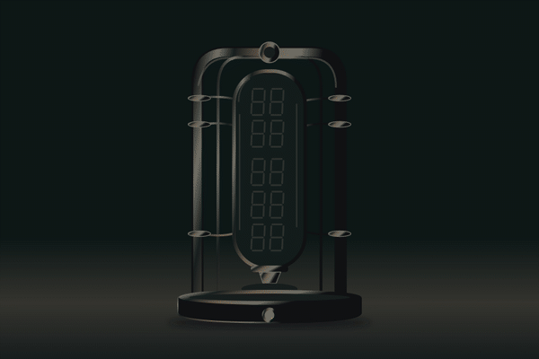
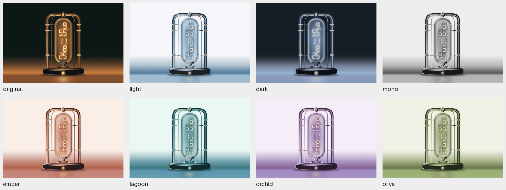

# Amber glass tube clock

Five stacked seven-segment readouts sit behind a domed glass cage. A small power switch glows as a pool of amber light spreads across the desktop.

| | |
| --- | --- |
| **Category** | [Device screens › Smart displays](../) |
| **Size** | 864 × 576 CSS pixels, exported at 2× |
| **Colorways** | original, light, dark, mono, ember, lagoon, orchid, olive |
| **Fonts** | Original seven-segment SVG lettering and system sans-serif labels |
| **Icons** | Original inline SVG and CSS |
| **Animated** | Yes, 9.2-second loop at 24 fps |
| **Based on** | [A TikTok by @paulcodes4](https://www.tiktok.com/@paulcodes4/video/7700872607276617012) |

## Every colorway

## Files

- Open [the design](source/design.html) in a browser and append `#ember` to select that colorway. Add `?t=2.1#ember` after the filename to show the export still.
- [The exports folder](exports/) contains a PNG and an H.264 MP4 loop for each colorway.

## Changing it

Select the base to toggle power and show the local hour, minute, month, date and year. The exported readout uses the values visible in the reference.

The custom properties at the top of `source/design.html` define each palette. Copy a palette block, give it a new colorway name, then run `python3 .github/scripts/export_design.py device-screens/smart-displays/amber-glass-tube-clock` from the repository root.
