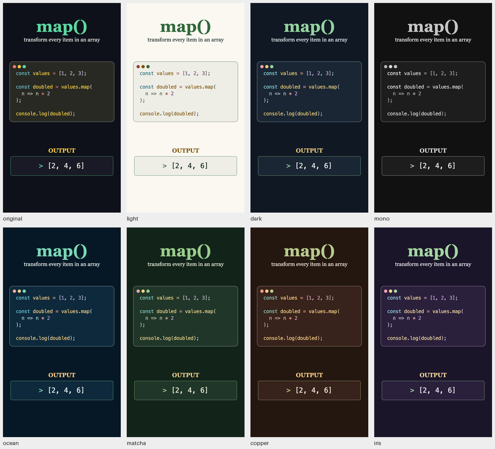

# Green array methods

Five array methods share a mint serif heading, a syntax-colored inset and an outlined output. The final card recaps all five methods.

| | |
| --- | --- |
| **Category** | [Education › Flashcards](../) |
| **Size** | 576 × 1024 |
| **Colorways** | original, light, dark, mono, ocean, matcha, copper, iris |
| **Fonts** | Georgia for headlines and Menlo with system monospace fallbacks for code. |
| **Artwork** | Six editable cards with original, working examples. |
| **Animated** | 36-second loop, 24 fps |
| **Based on** | [A TikTok by @paulcodes4](https://www.tiktok.com/@paulcodes4/video/7693826541435866388) |

## Every colorway

## Files

Open [the design](source/design.html) and add `#ocean` to its address to change the colorway. The [exports](exports/) contain a PNG for every palette, plus a matching MP4. Every slide also has a full-size PNG under each colorway in `exports/slides/`.

## Changing it

The CSS variables at the top of the source define the colors. Arrow keys select a card. Add `?slide=4` to open a particular method. Run `python3 .github/scripts/export_design.py education/flashcards/green-array-methods` to regenerate the media.
