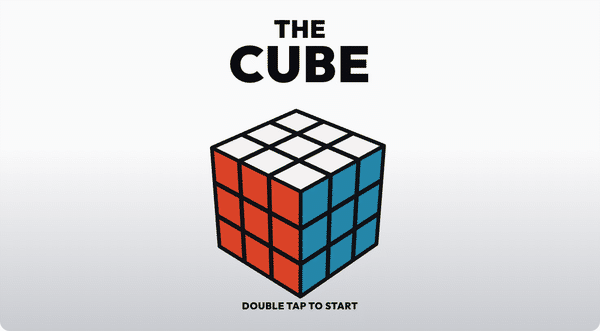
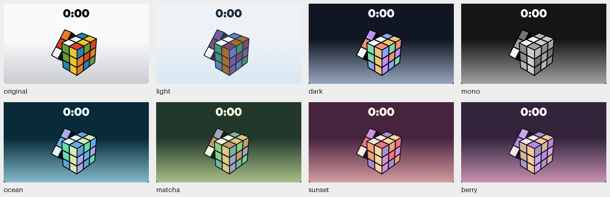

# Turning color cube

A six-color twisty cube rests on a pale gray stage. The title and start instruction give way to independently turning layers and a digital puzzle timer.

| | |
| --- | --- |
| **Category** | [Games › Board games](../) |
| **Size** | 554 × 306 CSS pixels, exported at 2× |
| **Colorways** | original, light, dark, mono, ocean, matcha, sunset, berry |
| **Fonts** | Outfit, bundled under the SIL Open Font License |
| **Artwork** | Original projected three-dimensional cubelets, face colors and camera geometry. |
| **Animated** | Yes, 15.25-second loop at 24 fps |
| **Based on** | [A TikTok by @paulcodes4](https://www.tiktok.com/@paulcodes4/video/7694923852127800597) |

## Every colorway

## Files

- [Open the standalone design](source/design.html). Double-click to start. Click or press Space to turn a layer, and drag to adjust the viewing angle.
- Add `#ocean` to switch palettes or `?t=8.0#ocean` to freeze the animation.
- [Exports](exports/) holds the colorway PNGs and H.264 loops.

## Changing it

Edit the palette variables at the top of [the source](source/design.html), then run `python3 .github/scripts/export_design.py games/board-games/turning-color-cube` from the repository root.
