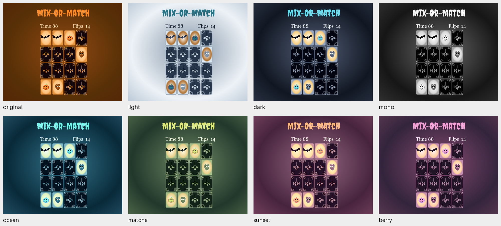

# Cobweb memory parlor

An amber Halloween memory game opens with a dark start screen. Sixteen spider-backed cards flip to reveal original seasonal symbols while the clock and flip counter advance through to the victory screen.

| | |
| --- | --- |
| **Category** | [Games › Card games](../) |
| **Size** | 576 × 473 CSS pixels, exported at 2× |
| **Colorways** | original, light, dark, mono, ocean, matcha, sunset, berry |
| **Fonts** | Creepster (SIL Open Font License) and Georgia |
| **Artwork** | Original SVG card backs, cobwebs, spider and eight illustrated seasonal pairs. |
| **Animated** | Yes, 27.875-second loop at 24 fps |
| **Based on** | [A TikTok by @paulcodes4](https://www.tiktok.com/@paulcodes4/video/7701976649218198804) |

## Every colorway

## Files

- [Open the standalone design](source/design.html). Select the stage and turn two cards at a time to find all eight matching pairs. Select the victory screen to play again.
- Add `#ocean` to switch palettes or `?t=13.5#ocean` to freeze the animation.
- [Exports](exports/) holds the colorway PNGs and H.264 loops.

## Changing it

Edit the palette variables at the top of [the source](source/design.html), then run `python3 .github/scripts/export_design.py games/card-games/cobweb-memory-parlor` from the repository root.
