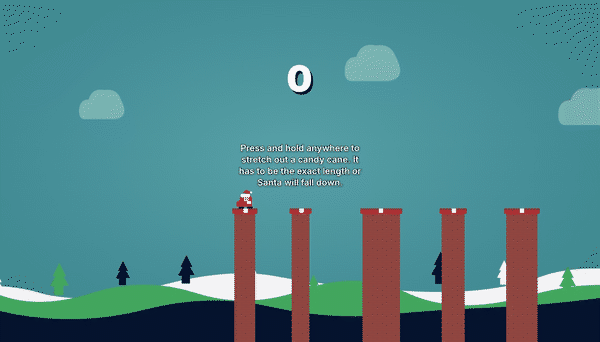
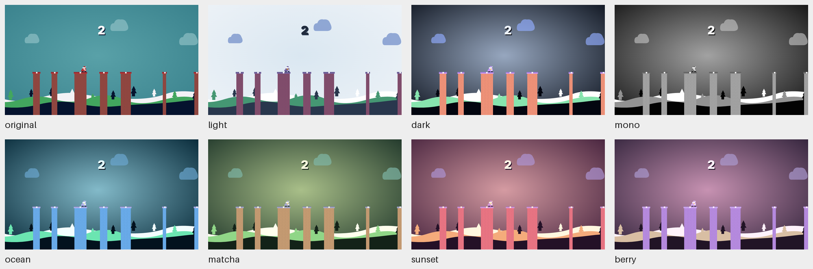

# Snowbound chimney crossing

A tiny winter courier crosses rows of brick chimneys above snowy hills. A held input grows a bridge, a successful landing advances the score, and a missed crossing brings up the red restart button.

| | |
| --- | --- |
| **Category** | [Games › Game UI](../) |
| **Size** | 576 × 328 CSS pixels, exported at 2× |
| **Colorways** | original, light, dark, mono, ocean, matcha, sunset, berry |
| **Fonts** | Inter, bundled under the SIL Open Font License |
| **Artwork** | Original layered vector scenery, courier, bridges and brickwork. |
| **Animated** | Yes, 14.0833-second loop at 24 fps |
| **Based on** | [A TikTok by @paulcodes4](https://www.tiktok.com/@paulcodes4/video/7698268524430593301) |

## Every colorway

## Files

- [Open the standalone design](source/design.html). Press and hold to grow a bridge. Release it to cross, and select Restart after a missed landing.
- Add `#ocean` to switch palettes or `?t=3.95#ocean` to freeze the animation.
- [Exports](exports/) holds the colorway PNGs and H.264 loops.

## Changing it

Edit the palette variables at the top of [the source](source/design.html), then run `python3 .github/scripts/export_design.py games/game-ui/snowbound-chimney-crossing` from the repository root.
